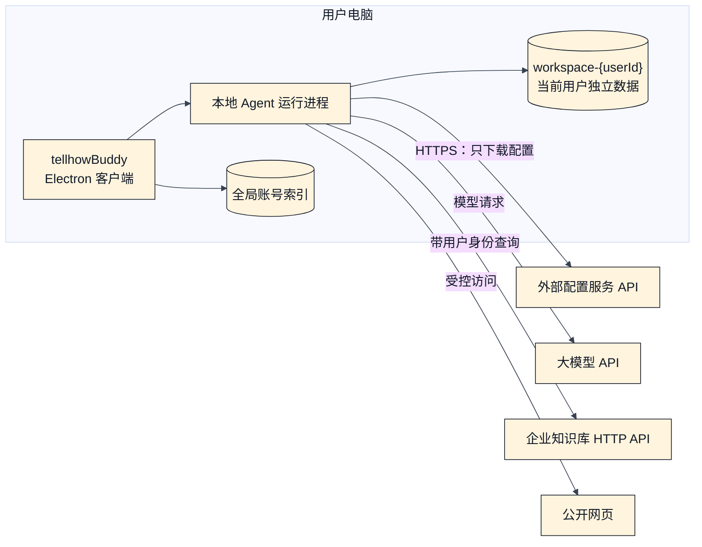
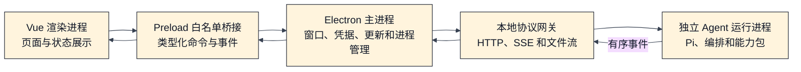
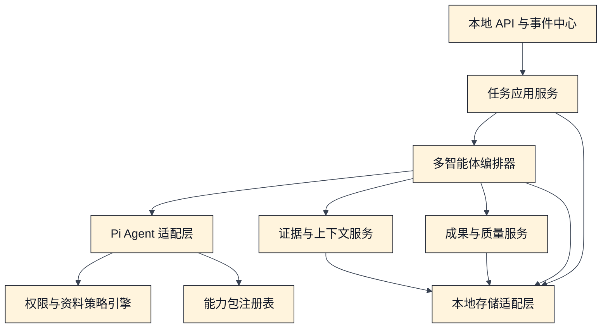
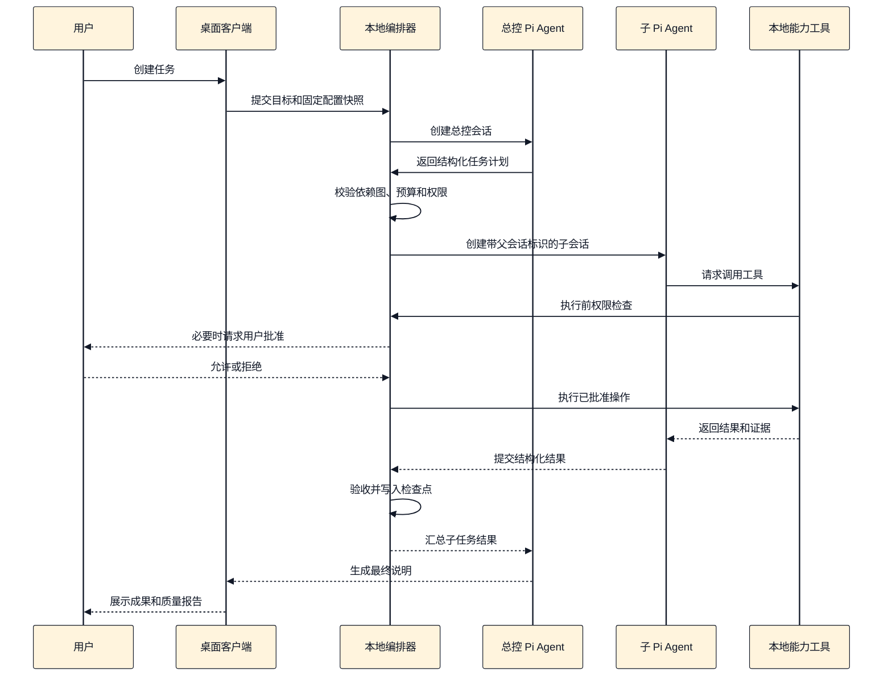
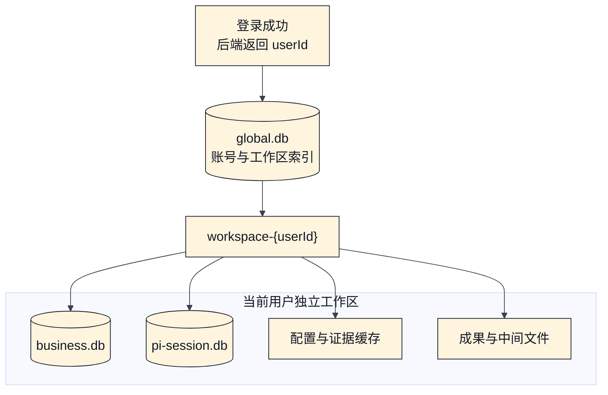

# tellhowBuddy 技术架构设计

- 日期：2026-08-14
- 状态：技术方案已确认，待文档评审
- 产品名称：tellhowBuddy
- 客户端基础：Electron + Vue 3 + TypeScript
- Agent 内核：Pi `@earendil-works/pi-agent-core`
- 核心部署方式：Electron 客户端 + 独立本地 Agent 运行进程 + 外部服务接口

## 1. 文档目标

本文描述 tellhowBuddy 的工程实现方式，回答以下问题：

- 客户端、Pi Agent 和本地多智能体编排器分别运行在哪里。
- Electron 各进程之间如何隔离和通信。
- 总控 Agent 与子 Agent 如何创建、调度、暂停、恢复和验收。
- 会话、任务、证据、配置快照和办公成果如何存储。
- 客户端如何从外部接口取得专家、Skills、提示词、模板和策略并固定版本。
- 网页、企业知识库、大模型和文件生成能力如何接入。
- 系统如何保证权限、安全、可恢复性、可测试性和版本兼容性。

产品功能、用户角色和业务范围以《tellhowBuddy 本地多智能体办公平台架构设计》为准。本文不重复产品功能说明，只定义技术落地方案。

## 2. 已确认的技术边界

| 边界 | 技术约束 |
| --- | --- |
| Agent 执行 | 所有 Pi Agent 实例均在用户电脑上运行，不依赖远程 Agent 执行实例 |
| 会话数据 | Pi 会话、消息、工具结果、任务检查点和成果只保存在客户端 |
| 账号识别 | 所有登录方式成功后均由后端返回稳定 `userId`；token 只用于认证，不作为数据归属标识 |
| 用户隔离 | 每个 `userId` 使用独立 `workspace-{userId}`，不同用户不共享业务库、Pi 会话库和文件缓存 |
| 外部配置接口 | 提供专家、Skills、系统提示词、规则、模板、能力清单、模型策略和组织策略的版本化快照 |
| 配置使用 | 客户端下载签名配置快照；任务创建时固定快照，运行中不被新发布版本改变 |
| 企业知识 | 企业知识库位于服务端，通过现有登录、权限和 HTTP API 接入 |
| 首期资料源 | 公开网页和企业知识库 |
| 首版成果 | 根据模板生成新的 DOCX、XLSX、PPTX 和 PDF |
| Office 依赖 | 不依赖用户安装 Microsoft Office |
| 编码能力 | 作为可选能力包安装，不进入通用办公底座 |

客户端不实现会话、消息、工具结果和成果文件上传。诊断遥测默认只包含版本、错误码、耗时和成功率等脱敏元数据。

## 3. 架构选型

### 3.1 采用独立本地 Agent 运行进程

Pi Agent、多智能体调度和工具执行不放在 Electron 渲染进程或主进程中，而是放入独立本地进程。Electron 主进程负责启动、认证、监控和关闭该进程。

采用该方案的原因：

1. Agent 或文档生成器异常时，不会直接拖垮界面进程。
2. 本地运行进程可以独立重启，并从 SQLite 和检查点恢复。
3. 渲染进程不接触模型密钥、知识库令牌、文件系统和进程执行权限。
4. Agent 运行时以后可以独立做性能分析、并发限制和故障注入。
5. 本地 HTTP/SSE 协议稳定后，可以避免桌面界面与运行时实现强耦合。

### 3.2 外部接口边界

tellhowBuddy 客户端只依赖配置服务 API 和企业知识库 API 的接口契约，不描述它们的内部模块、存储、部署和技术选型。本文只规定客户端请求什么、校验什么、缓存什么，以及哪些客户端数据禁止上传。

### 3.3 不采用的方案

- **Agent 直接运行在 Electron 主进程**：实现简单，但模型流、文件渲染或原生库异常会影响窗口和更新流程。
- **Agent 远程运行**：会改变本地执行和本地会话边界，也会把用户任务内容带离客户端。

## 4. 部署拓扑



图中的“本地执行”是指 Agent 循环、任务编排、工具调用和成果生成发生在用户电脑。大模型推理可以调用企业模型网关或外部模型 API，但必须经过资料分级和模型策略检查。

## 5. 客户端进程架构



### 5.1 Vue 渲染进程

职责：

- 展示任务、会话、子 Agent、权限请求、资料、引用和成果。
- 保存短期界面状态，不保存凭据和权威任务状态。
- 通过 preload 暴露的类型化 API 提交命令和订阅事件。

安全要求：

- `nodeIntegration: false`。
- `contextIsolation: true`。
- 生产环境启用渲染进程沙箱和严格 CSP。
- 不直接读取文件、系统凭据、SQLite 或本地运行进程认证密钥。
- 不把大文件完整读入前端内存，通过受控文件流或自定义协议预览。

当前工程中的 `sandbox: false` 只可作为初始脚手架状态，进入业务开发后应改为安全默认值。

### 5.2 Preload 白名单桥接

Preload 只暴露稳定的业务命令，例如：

- `task.create`、`task.cancel`、`task.resume`
- `message.append`
- `permission.decide`
- `artifact.open`、`artifact.export`
- `config.sync`
- `event.subscribe`

桥接层使用共享协议包校验输入和输出，不暴露通用 IPC、任意路径、任意 URL 或任意命令执行能力。

### 5.3 Electron 主进程

职责：

- 管理窗口、菜单、通知、文件选择器和系统托盘。
- 从系统凭据库读取模型和企业身份令牌。
- 使用登录结果中的稳定 `userId` 查找、创建和切换 `workspace-{userId}`。
- 启动本地运行进程，完成一次性握手，并监控心跳。
- 代理渲染进程与本地运行进程之间的命令和事件。
- 管理客户端签名更新、协议兼容检查和本地目录权限。
- 在应用退出时请求运行进程完成检查点并有序关闭。

### 5.4 本地 Agent 运行进程

首版可使用 Electron `utilityProcess` 或打包后的 Node.js 子进程承载。进程启动后只监听 `127.0.0.1` 的随机端口，通过父进程传入的一次性密钥完成握手。握手必须绑定当前 `workspaceId`，端口、密钥和 token 不得写入日志。

本地运行进程包含：

- Pi Agent 适配层
- 多智能体编排器
- 任务调度器和消息信箱
- 权限与资料策略引擎
- 上下文和证据管理
- 能力包注册表
- 办公成果引擎
- 本地存储和事件中心
- 配置同步客户端

## 6. 本地运行进程内部结构



### 6.1 分层规则

依赖方向固定为：

```text
协议与领域模型 -> 应用服务 -> 基础设施接口 -> 具体适配器
```

领域模型不得依赖 Electron、Pi、具体模型 SDK、SQLite 驱动、HTTP 框架或具体办公文件库。Pi、数据库、模型、知识库和文件生成器都通过适配器接入。

### 6.2 Pi Agent 适配层

Pi Agent Core 负责单个 Agent 的模型与工具循环。适配层负责把 tellhowBuddy 的领域对象转换成 Pi 配置：

| Pi 能力 | tellhowBuddy 接入方式 |
| --- | --- |
| `Agent` | 创建总控和子 Agent 实例 |
| `AgentTool` | 包装网页、知识库、文件生成和其他能力包工具 |
| `beforeToolCall` | 执行权限、资料分级、路径和域名检查 |
| `afterToolCall` | 写入工具记录、证据引用、质量结果和审计元数据 |
| `transformContext` / `convertToLlm` | 注入配置快照、证据片段和应用自定义消息 |
| steering / follow-up | 处理运行中的用户调整和排队追加要求 |
| session backend | 保存 Pi 消息、分支、压缩、工具记录和恢复信息 |
| `parentSessionId` | 建立总控与子 Agent 的父子关系 |

Pi 的并行工具调用只属于单个 Agent 内部能力，不承担 tellhowBuddy 的跨 Agent 编排。任务依赖图、并发、预算、权限和结果验收由 tellhowBuddy 编排器负责。

### 6.3 多智能体编排器

编排器包含以下组件：

- **任务规划器**：要求总控 Agent 输出结构化计划，并用模式定义进行校验。
- **依赖图管理器**：保存任务 DAG，拒绝循环依赖和缺少验收条件的任务。
- **调度器**：根据依赖、并发槽位、预算、权限和资源锁选择可运行任务。
- **Agent 实例池**：创建、暂停、取消和销毁 Pi Agent 实例。
- **配置装配器**：将固定版本的专家、Skill、提示词、模型和能力清单装配到 Agent。
- **消息信箱**：在总控和子 Agent 之间传递追问、结果、取消和验收消息。
- **结果验收器**：检查结构化输出、证据完整性和业务验收条件。
- **检查点管理器**：只在可安全恢复的位置记录检查点。

默认最多并行运行 4 个子 Agent。组织策略和设备能力可以降低该值；单个任务不得自行突破全局并发、令牌、时间和费用预算。

## 7. 多智能体任务执行流程



### 7.1 任务和子任务状态

任务状态至少包括：

```text
draft -> planning -> running -> succeeded
                    |        -> failed
                    |        -> canceled
                    -> waiting_permission
                    -> paused
                    -> recovery_required
```

所有状态转换都必须先持久化事件，再向界面发布。界面不是状态权威来源。

### 7.2 结构化计划

每个子任务必须包含：

- 唯一标识、目标和输入
- 前置依赖和资源锁
- 专家配置版本和所需 Skills
- 能力包及最小权限
- 资料范围和数据等级
- 令牌、时间、调用次数和费用预算
- 结构化输出模式
- 验收条件和失败策略

计划修改产生新版本。已经完成的子任务不会因计划变化而被隐式重跑。

## 8. 外部配置接口与本地快照

本文把配置服务视为外部依赖，只定义客户端需要的接口契约。外部接口向客户端提供专家、Skills、系统提示词、模板、能力清单、模型策略和组织策略的已发布版本。

Skills 是方法和领域规则，不是获得系统权限的可执行脚本。可执行能力代码通过客户端签名更新或签名能力包分发，客户端不能把任何外部文本当作本地代码执行。

### 8.1 不可变配置快照

任务使用的快照清单至少包含：

```json
{
  "snapshotId": "cfg_...",
  "expertVersions": {},
  "skillVersions": {},
  "promptVersions": {},
  "templateVersions": {},
  "capabilityVersions": {},
  "policyVersion": "...",
  "compatibleClient": ">=1.0.0 <2.0.0",
  "contentHashes": {},
  "issuedAt": "...",
  "signature": "..."
}
```

客户端按以下顺序处理快照：

1. 验证签名、内容哈希、当前 `userId` 的授权结果和客户端兼容范围。
2. 下载缺失的模板、素材和配置内容，并逐项校验哈希。
3. 将完整快照写入只读缓存。
4. 创建任务时把 `snapshotId` 和全部依赖版本写入任务记录。
5. 运行中始终从固定快照装配 Agent。

外部接口改变推荐版本时，只影响新任务。历史任务仍从客户端已固定的快照装配 Agent；若快照依赖内容在本机不完整，则任务进入待修复状态，不能静默改用新版本。

## 9. 企业知识库与网页研究

### 9.1 企业知识库连接器

企业知识库连接器是本地能力包，但实际查询由外部知识库 API 执行。它负责：

- 使用当前用户的企业身份，不使用共享超级账号。
- 支持查询、分页、内容读取、权限拒绝和令牌刷新。
- 把来源 ID、标题、更新时间、权限范围和定位信息转换为统一证据格式。
- 不在客户端持久化超出任务需要的完整知识库镜像。
- 知识库返回拒绝时停止使用该来源，不由模型推测或绕过。

### 9.2 网页研究连接器

网页访问必须经过域名策略、协议限制、私网地址拦截、下载大小和超时限制。网页内容作为不可信资料进入上下文，不能覆盖系统提示词、组织策略或工具权限。

### 9.3 统一证据包

报告、表格、演示和 PDF 使用同一份规范化证据包。核心字段包括：

- `evidenceId`
- 来源类型和来源标识
- 标题、作者、发布时间和抓取时间
- 原始定位信息和引用片段
- 内容哈希和访问权限
- 数据等级和允许发送的模型范围
- 抽取事实、指标定义、时间范围和单位
- 可信度、冲突和缺口标记

成果文件不能各自重新解释原始资料。数字和结论先进入证据包，再由不同成果生成器消费，从而保证跨文件一致性。

## 10. 办公成果技术链路

办公成果生成采用统一管线：

```text
证据包
  -> 成果内容模型
  -> 模板绑定
  -> 格式生成器
  -> 结构验证
  -> 页面渲染
  -> 视觉检查
  -> 事实与引用检查
  -> 成果版本入库
```

### 10.1 通用成果模型

通用成果模型保存章节、段落、表格、图表、幻灯片、引用、数据绑定和样式令牌。具体 DOCX、XLSX、PPTX 和 PDF 生成器只负责把该模型转换为目标格式，不直接向 Agent 暴露底层文件结构。

### 10.2 格式适配器

- DOCX：模板字段、章节、页眉页脚、表格、图片、目录和引用。
- XLSX：数据表、公式、命名区域、格式、图表和打印设置。
- PPTX：母版、版式、文本、图片、图表、讲者备注和引用。
- PDF：由受控内容模型直接生成，或由其他成果的稳定渲染结果转换。

每个格式适配器必须同时提供生成器、解析验证器和渲染器。文件能打开只是最低要求，最终版本还必须通过视觉检查。

### 10.3 成果版本

成果保存为不可变版本。定向修改创建新版本并记录父版本、修改范围、使用的证据和配置快照。生成失败时保留最后一个有效版本，不覆盖原文件。

## 11. 本地数据架构

本地数据分为全局账号索引和每用户独立工作区。登录后端返回稳定 `userId`，客户端据此打开 `workspace-{userId}`。token 刷新不能改变工作区，业务表也不需要重复添加 `userId`。



推荐目录结构：

```text
app-data/
  global.db
  workspaces/
    workspace-{userId}/
      business.db
      pi-session.db
      config-cache/
      evidence-cache/
      artifacts/
      temp/
      logs/
```

目录名中的 `userId` 必须经过文件名安全校验或可逆的 URL-safe 编码。禁止直接接受包含路径分隔符、`..`、绝对路径或 Windows 保留设备名的值。首版客户端只连接一个固定登录环境，并要求 `userId` 在该环境内全局唯一。

### 11.1 全局账号索引 SQLite

`global.db` 只保存账号到本地工作区的映射和设备级状态，不保存用户会话、任务、证据或成果内容。

| 表 | 一行代表什么 | 关键字段或内容 | 用途 |
| --- | --- | --- | --- |
| `account_profile` | 一个登录过的用户 | 本地记录 ID、`userId`、显示名称、头像、状态、首次和最后登录时间 | 根据后端返回的稳定 `userId` 找到本地账号；`userId` 具有唯一约束 |
| `workspace` | 一个用户的本地数据工作区 | `workspaceId`、`userId`、名称 `workspace-{userId}`、目录、模式版本、最后打开时间、锁定状态 | 定位并管理该用户的业务库、Pi 会话库和文件目录 |
| `device_capability` | 本机安装的一个能力包版本 | 能力 ID、实现版本、安装路径、签名、接口版本、兼容范围和可用状态 | 设备级能力只存一份；调度时再与当前用户配置快照求交集 |
| `app_setting` | 一项设备级客户端设置 | 设置键、值、模式版本和更新时间 | 保存语言、主题、更新通道等不属于具体用户的数据 |

token、模型密钥和企业知识库令牌不写入 `global.db`。系统凭据库使用 `workspaceId` 作为索引保存当前用户凭据。

### 11.2 每用户 Pi 会话 SQLite

每个 `workspace-{userId}` 都有自己的 `pi-session.db`，由 Pi session backend 管理，保存：

- 会话和父子关系
- 消息、分支和压缩摘要
- 模型与工具变化
- operation/tool records
- steering/follow-up 队列
- 使用量和恢复信息

该数据库是当前用户会话的唯一权威来源，业务代码不直接修改 Pi 内部表。切换账号后必须销毁旧 Pi session backend，再用新路径创建实例。

### 11.3 每用户 tellhowBuddy 业务 SQLite

每个 `workspace-{userId}` 都有自己的 `business.db`。业务库记录“任务如何执行并产生成果”，建议使用 WAL 模式和显式迁移。它不保存聊天消息正文，消息正文只在同一工作区的 Pi 会话库中。因为数据库文件已经按用户物理隔离，下面的业务表不重复保存 `userId`。

| 表 | 一行代表什么 | 关键字段或内容 | 写入时机与用途 |
| --- | --- | --- | --- |
| `workspace_metadata` | 当前数据库所属工作区的单行元数据 | `workspaceId`、`userId`、工作区命名版本、数据库模式版本、创建时间 | 打开数据库时与登录结果和 `global.db` 交叉校验，不一致则拒绝挂载 |
| `task` | 一个主任务或子任务 | `id`、`rootTaskId`、`parentTaskId`、目标、状态、计划版本、预算、验收条件 | 创建或拆分任务时写入，状态转换时更新；它是调度器读取任务当前状态的权威表 |
| `task_dependency` | 两个任务之间的一条有向依赖边 | `fromTaskId`、`toTaskId`、依赖类型、满足条件、计划版本 | 计划通过校验后写入；调度器据此判断后置任务是否进入可运行队列 |
| `agent_run` | 某个任务的一次 Agent 执行尝试 | `taskId`、Pi `sessionId`、专家版本、尝试序号、状态、起止时间、错误码 | 每次首次运行或重试都新增一行；用于区分历史尝试，并把业务任务关联到 Pi 会话 |
| `event` | 已经发生的一件领域事件 | 单调递增 `sequence`、事件类型、对象 ID、时间、模式版本、结构化载荷 | 与业务状态同一事务写入后再推送；用于界面断线补发、任务时间线和故障诊断 |
| `config_snapshot` | 一个被任务固定的不可变配置包 | 外部配置 ID、各项版本、内容哈希、签名、兼容范围、缓存状态 | 创建根任务前完成校验并写入；运行时只按该记录装配 Agent，禁止自动漂移版本 |
| `tool_call` | Agent 请求执行的一次工具调用 | `agentRunId`、工具名、输入摘要、幂等键、权限状态、执行状态、结果引用、错误和副作用状态 | 工具执行前创建，执行后更新；用于审计、恢复及判断失败调用能否安全重试 |
| `permission_request` | 一次需要策略或用户决定的权限申请 | `toolCallId`、操作、资源范围、资料等级、风险、建议、决定、决定者、决定时间 | `beforeToolCall` 无法自动决策时写入；决定后更新，并唤醒或终止等待中的工具调用 |
| `evidence` | 一条可以被成果引用的证据 | `producerTaskId`、来源类型、来源定位、摘录、内容哈希、权限、数据等级、时间、可信度、原文文件引用 | 网页或知识库内容规范化后写入；数据库保存索引和摘要，大内容进入内容寻址文件库 |
| `artifact` | 一个逻辑成果，例如“年度总结报告” | `taskId`、类型、名称、状态、`currentVersionId`、导出位置 | 首次产生交付目标时创建；后续修改只切换当前版本，不改变成果的稳定 ID |
| `artifact_version` | 某个成果的一次不可变文件版本 | `artifactId`、父版本、文件路径、内容哈希、模板版本、配置快照、质量结果、创建任务 | 每次生成或定向修改成功后新增；用于比较、回退、复现和保留最后有效版本 |
| `artifact_evidence` | 一个成果版本对一条证据的引用 | `artifactVersionId`、`evidenceId`、成果内引用位置、引用用途 | 生成成果时写入；用于点击溯源、事实检查和 DOCX/XLSX/PPTX/PDF 跨文件一致性检查 |
| `checkpoint` | 一次经过确认的安全恢复边界 | `agentRunId`、任务状态版本、已完成步骤、待执行步骤、相关对象 ID、外部副作用状态、是否可自动恢复 | 完成可幂等步骤后写入；进程重启只使用最新安全记录，结果未知时要求人工确认 |

### 11.4 表之间怎样关联

```text
global.db
  -> account_profile(userId)
      -> workspace(workspaceId, workspace-{userId})
  -> device_capability（本机已安装能力及可用状态）

workspace-{userId}/business.db
  -> workspace_metadata（数据库归属校验）
  -> 根 task
  -> config_snapshot（该任务固定的完整配置版本）
  -> 子 task
      -> task_dependency（任务之间的依赖边）
      -> agent_run（一次任务可有多次执行尝试）
          -> Pi sessionId（消息正文位于 Pi 会话库）
          -> tool_call
              -> permission_request
          -> checkpoint
      -> evidence
      -> artifact
          -> artifact_version
              -> artifact_evidence -> evidence

  -> event -> task / agent_run / tool_call / permission_request / evidence / artifact
```

同一工作区的 Pi 会话库和业务库通过 `sessionId`、`agentRunId` 和 `taskId` 做逻辑关联，不建立跨库外键，也不尝试跨库分布式事务。业务库创建 `agent_run` 后再创建 Pi 会话；若后一步失败，则将该运行标记为失败并允许创建新的尝试记录，不能覆盖已有运行历史。

### 11.5 账号切换与文件目录

登录成功后，Electron 主进程用 `userId` 查询 `global.db`：已有记录则打开原工作区，没有记录则创建 `workspace-{userId}`、初始化两个 SQLite 并写入 `workspace_metadata`。

账号切换必须按以下顺序执行：

1. 拒绝新任务进入旧工作区。
2. 暂停旧工作区运行中的任务并写入安全检查点。
3. 停止旧工作区的 Agent、SSE 订阅和知识库请求。
4. 关闭旧工作区的 `business.db` 和 `pi-session.db`。
5. 清除旧用户的内存上下文、令牌引用和预览文件句柄。
6. 校验并打开新用户的工作区，重新创建 Pi session backend。
7. 只恢复新工作区自己的任务和事件。

首版同一时刻只允许一个活动工作区。退出登录默认保留本地工作区但锁定访问；删除本地用户数据必须显式确认，并只删除匹配 `workspace_metadata.userId` 的目录。

### 11.6 大对象和成果目录

- 网页快照、证据附件和中间渲染只写入当前 `workspace-{userId}`，以 SHA-256 去重和校验。
- 默认成果写入当前用户工作区；导出到外部目录必须由用户明确选择路径。
- 临时文件先写临时路径，验证成功后使用原子重命名发布。
- 数据库只保存路径、哈希、大小、类型和引用计数，不保存大型二进制内容。
- 令牌和密钥只进入系统凭据库，不写入 SQLite、配置文件或日志。

## 12. 通信协议

### 12.1 渲染进程与主进程

使用 Electron IPC，但只暴露业务级白名单接口。请求和事件由 `packages/protocol` 中的共享模式校验，协议包含显式版本。

### 12.2 主进程与本地运行进程

- HTTP JSON：创建任务、追加消息、权限决定、取消、恢复和查询。
- SSE：推送任务、Agent、工具、权限、证据、成果和错误事件。
- 受控文件流：读取预览和导出成果，不把大文件编码进 JSON。
- 健康检查：进程版本、Pi 版本、数据库迁移版本和能力清单。

建议的本地接口：

```text
POST /v1/tasks
GET  /v1/tasks/{taskId}
POST /v1/tasks/{taskId}/messages
POST /v1/tasks/{taskId}/cancel
POST /v1/tasks/{taskId}/resume
POST /v1/permissions/{requestId}/decision
GET  /v1/events
GET  /v1/artifacts/{artifactId}
GET  /v1/health
```

所有本地请求必须携带当前 `workspaceId`；会改变状态的请求还必须携带幂等请求标识。本地运行进程只接受与启动握手一致的工作区。SSE 序号在每个工作区内单调递增，界面重连时同时提交 `workspaceId` 和 `Last-Event-ID`。

### 12.3 客户端与外部配置接口

使用独立 HTTPS API，只允许登录、查询目录、下载快照、模板和策略。协议中不存在会话、消息、工具结果或成果上传资源。

### 12.4 事件信封

统一事件至少包含：

```json
{
  "eventId": "evt_...",
  "workspaceId": "workspace-user_10086",
  "sequence": 123,
  "taskId": "task_...",
  "agentRunId": "run_...",
  "type": "artifact.created",
  "occurredAt": "...",
  "schemaVersion": 1,
  "payload": {}
}
```

事件先落当前用户的业务 SQLite，再推送给界面。主进程和渲染进程都必须校验 `workspaceId`，账号切换后丢弃旧工作区迟到的事件。界面断开不会丢失任务状态。

## 13. 权限与安全架构

### 13.1 权限执行顺序

每次工具调用按以下顺序处理：

1. 校验能力包是否安装、签名有效且被配置快照允许。
2. 校验 Agent 的工具白名单和子任务最小权限。
3. 校验资料等级能否发送给目标模型、网页或外部系统。
4. 校验文件路径、网络域名、操作类型和资源范围。
5. 根据策略自动允许、拒绝或请求用户确认。
6. 执行后记录结果摘要、证据、实际影响范围和审计元数据。

模型只能提出工具调用请求，不能直接授予自己权限。

### 13.2 关键安全措施

- 本地运行进程只绑定回环地址，使用随机端口和一次性认证密钥。
- 渲染进程不持有本地运行进程密钥和企业访问令牌。
- 登录 token 只负责认证；本地工作区归属只使用后端返回的稳定 `userId`。
- token 在系统凭据库中按 `workspaceId` 隔离，token 刷新不得创建新工作区。
- 打开用户数据库前必须同时校验 `global.db` 映射、目录名和 `workspace_metadata`，三者的 `userId` 必须一致。
- 账号切换时必须停止旧 Agent、关闭旧数据库并清理旧用户内存，禁止两个用户共享运行时上下文。
- 模型、知识库和组织令牌存入 Windows Credential Manager、macOS Keychain 或 Linux Secret Service。
- 文件能力使用规范化绝对路径和允许目录，阻止路径穿越与符号链接逃逸。
- 网页研究阻止 `file:`、未批准协议、私网地址和重定向绕过。
- 网页和知识库内容标记为不可信数据，进入上下文前执行提示注入检测与隔离。
- 配置快照、能力包和客户端更新都必须验证签名、哈希和兼容版本。
- 日志自动清除令牌、个人信息、企业敏感原文和完整模型上下文。
- 企业策略优先于本地用户偏好，并在每次敏感工具调用前重新校验。

### 13.3 数据发送模型前检查

策略引擎根据“资料等级 × 模型部署位置 × 组织策略”决定是否允许发送。被禁止的数据不进入模型请求，即使总控或子 Agent 在提示词中要求也不能绕过。

## 14. 容错、重试与恢复

| 故障 | 技术处理 |
| --- | --- |
| 渲染进程刷新或崩溃 | 从业务库重建界面状态，并按事件序号补发事件 |
| Electron 主进程异常 | 重启后重新发现本地数据库，并检查是否存在孤立运行进程 |
| 本地运行进程崩溃 | 主进程按退避策略重启；运行时从最后安全检查点恢复 |
| 账号切换中途失败 | 旧工作区保持锁定；未完成新工作区校验前不启动 Agent，也不回退到混合状态 |
| 电脑休眠或关机 | 写入检查点；重新打开后进入暂停或待恢复状态 |
| 模型流中断 | 对无外部副作用的模型请求退避重试，并记录实际模型和尝试次数 |
| 外部工具结果未知 | 禁止自动重复，先查询外部状态或请求用户决定 |
| 配置服务不可用 | 允许使用已验证且仍有效的缓存快照；不能启动缺少配置的新任务 |
| 知识库令牌过期 | 暂停依赖该资料的子任务，完成身份刷新后继续 |
| 数据库写入失败 | 停止继续执行有副作用步骤，保留临时文件并报告恢复要求 |
| 成果生成失败 | 保留最后有效版本，只重跑受影响的成果子任务 |

### 14.1 检查点原则

只有满足以下条件才写入“可自动恢复”检查点：

- 前序数据库事务已提交。
- 文件已完成原子发布或仍处于明确的临时状态。
- 外部副作用结果确定。
- 当前配置快照和能力版本仍可用。
- 下一步操作可幂等执行。

不满足条件时标记为 `recovery_required`，由用户确认后继续。

## 15. 客户端本地可观测性

- JSON 结构化日志，包含任务、Agent、工具、事件和错误关联标识。
- 指标包括模型首字延迟、总耗时、令牌、子任务等待时间、工具成功率和成果验证耗时。
- 本地任务时间线可从事件表重放。
- 诊断包由用户主动导出，并在导出前展示包含范围和执行脱敏。
- 外部接口调用只记录客户端侧的请求标识、接口类型、耗时、状态码和错误码，不记录令牌、请求正文或返回原文。

## 16. 客户端推荐技术栈

| 层次 | 推荐技术 |
| --- | --- |
| 桌面框架 | Electron 39，沿用现有工程 |
| 前端 | Vue 3、TypeScript、Vite |
| 页面状态 | Pinia；权威任务状态仍来自本地运行进程 |
| 协议校验 | Zod 或同类 TypeScript 模式库 |
| 本地运行进程 | Node.js / TypeScript 独立进程 |
| Agent | `@earendil-works/pi-agent-core` |
| 本地 API | Fastify 或同级轻量 HTTP 框架 + SSE |
| 全局账号索引 | `global.db`，SQLite WAL + 显式迁移 |
| 每用户业务数据库 | `workspace-{userId}/business.db`；可使用 `better-sqlite3` 和 Drizzle |
| 每用户会话数据库 | `workspace-{userId}/pi-session.db`，使用 Pi SQLite session backend |
| 凭据 | Electron `safeStorage` 配合系统凭据库适配器 |
| 测试 | Vitest、Playwright、契约测试和故障注入测试 |
| 打包更新 | electron-builder、electron-updater 和代码签名 |

表中新增库是推荐基线，接入前仍需通过原生模块打包、许可证和企业安全审查。外部服务采用何种语言、数据库和部署方式不在本文范围内；客户端只依赖 HTTPS 接口契约、签名和版本语义。

## 17. 推荐工程结构

```text
apps/desktop                 Electron 主进程、preload 和 Vue 工作台
apps/agent-runtime           独立本地 Agent 运行进程入口

packages/protocol            IPC、本地 API、事件和版本协议
packages/domain              任务、证据、成果、权限和状态机
packages/pi-runtime          Pi Agent 与会话后端适配
packages/orchestrator        计划、依赖图、调度、消息和验收
packages/policy              权限、资料分级和组织策略
packages/config-client       外部配置接口适配、签名校验和快照固定
packages/capability          能力包协议、注册表和生命周期
packages/research            网页访问、提取和引用
packages/knowledge           企业知识库 HTTP API 连接器
packages/evidence            统一证据包和事实一致性
packages/artifacts           通用成果模型、版本和质量报告
packages/docx                DOCX 模板、生成和验证
packages/xlsx                XLSX 数据、公式、图表和验证
packages/pptx                PPTX 母版、生成和验证
packages/pdf                 PDF 生成、转换和验证
packages/render              页面渲染、截图和视觉检查
packages/storage             SQLite、事件、检查点和内容存储
packages/identity            登录、令牌和系统凭据适配
packages/testing             模型录制、伪知识库和故障注入
packages/code-pack           可选编码能力；通用底座不得依赖
```

建议将客户端工程目录统一命名为 `tellhowBuddy-client`，并逐步调整为工作区结构，而不是一次性重写。第一步只抽取 `protocol`、`domain`、`pi-runtime` 和 `agent-runtime`，形成最小可运行闭环。

## 18. 版本和兼容性

系统同时管理以下版本：

- 客户端版本
- 本地协议版本
- Pi Agent Core 版本
- `global.db` 模式版本
- 用户工作区命名规则版本
- 业务数据库迁移版本
- Pi 会话数据库版本
- 配置快照模式版本
- 专家、Skill、提示词、模板和策略版本
- 能力包接口和实现版本

启动握手必须返回上述兼容信息。发现不兼容时，允许用户查看历史任务和成果，但禁止创建可能损坏数据的新任务。

数据库迁移必须向前执行并在升级前备份。客户端自动更新采用签名制品、灰度渠道和失败回滚；配置发布与客户端发布彼此独立，但通过兼容范围约束。

## 19. 测试架构

1. **领域单元测试**：任务状态机、依赖图、预算、权限、事件和检查点。
2. **Pi 适配测试**：事件顺序、工具钩子、父子会话、压缩、steering/follow-up 和恢复。
3. **协议契约测试**：IPC、本地 HTTP/SSE、配置 API、知识库 API 和模式兼容性。
4. **账号与工作区测试**：扫码登录、首次创建、重复登录复用、token 刷新、账号切换、旧事件丢弃、数据库误挂载拒绝、目录名攻击和用户数据删除。
5. **存储测试**：全局库和每用户数据库迁移、WAL、崩溃恢复、原子文件发布、内容哈希和引用计数。
6. **配置测试**：签名、哈希、依赖、灰度、回滚、离线缓存和任务版本固定。
7. **安全测试**：跨用户读取、渲染进程逃逸、路径穿越、SSRF、提示注入、越权查询和日志泄漏。
8. **多智能体集成测试**：并发、取消、追问、权限等待、子任务失败和结果验收。
9. **成果结构测试**：DOCX、XLSX、PPTX 和 PDF 可解析且关键结构完整。
10. **渲染视觉测试**：页面截图检查溢出、重叠、缺图、字体替换和分页变化。
11. **桌面端到端测试**：从登录、工作区切换、配置同步、任务创建到重启恢复、成果预览和导出。

模型测试使用录制响应或确定性测试提供器。核心逻辑测试不能依赖在线模型随机输出。

## 20. 分阶段技术落地

### 第一阶段：本地运行骨架

- 加固 Electron 进程边界和 preload 白名单。
- 建立独立本地运行进程、握手、健康检查、HTTP/SSE 和进程恢复。
- 接入 Pi Agent Core 和 Pi SQLite 会话后端。
- 建立 `global.db`、`workspace-{userId}`、每用户两套 SQLite、事件表和最小任务状态机。

### 第二阶段：配置接口接入

- 对接既有外部配置接口及其认证方式。
- 完成快照下载、签名校验、缓存、兼容检查和任务版本固定。
- 用契约测试保证客户端只下载配置，不上传会话与成果。

### 第三阶段：研究与首个成果闭环

- 接入网页研究、企业知识库和统一证据包。
- 优先完成 DOCX 模板生成、渲染预览、质量检查和成果版本。

### 第四阶段：本地多智能体

- 建立总控与子 Pi Agent、任务 DAG、调度、消息信箱、预算和验收。
- 支持并行研究、权限等待、取消和崩溃恢复。

### 第五阶段：多格式成果

- 扩展 XLSX、PPTX 和 PDF。
- 建立报告、表格和演示之间的事实与指标一致性检查。

### 第六阶段：企业治理和生态

- 完善企业身份、组织策略、模型路由、能力签名和脱敏遥测。
- 增加更多办公连接器和可选编码能力包。

## 21. 技术验收标准

- 结束本地运行进程后，Electron 界面保持可用并能提示和触发恢复。
- 渲染进程无法直接读取模型密钥、知识库令牌、SQLite 和任意本地文件。
- 所有 Agent 实例通过客户端 Pi Agent Core 运行，不依赖远程 Agent 执行实例。
- Pi 会话、消息、工具结果、检查点和成果不通过外部配置接口上传。
- 运行中任务固定完整配置快照，外部推荐版本变化不会静默改变其行为。
- 总控和子 Agent 具有独立 Pi 会话，并通过 `parentSessionId` 建立关系。
- 界面重连能够按事件序号恢复，不依赖内存中的临时状态。
- 不同 `userId` 必须映射到不同 `workspace-{userId}`；任何本地查询、事件补发、Agent 恢复和文件预览都不能跨用户工作区。
- token 刷新后继续使用原工作区；切换账号后旧工作区的迟到事件不能进入新账号界面。
- 本地运行进程崩溃后只从安全检查点恢复，不重复结果未知的外部操作。
- 知识库每次查询都使用用户身份并接受服务端最终权限判断。
- 未批准的企业资料无法发送到公开网页或不允许的模型。
- DOCX、XLSX、PPTX 和 PDF 成果均经过结构验证和渲染视觉检查。
- 多种成果引用同一证据包，关键事实、数字、时间范围和单位保持一致。
- 新能力包无需修改编排器核心和业务数据库结构即可接入。
- 关闭可选编码能力后，通用办公任务和成果生成仍可完整运行。

## 22. 明确不做的技术范围

首版不实现：

- 云端 Agent 托管和跨设备会话同步
- 会话、消息和成果的云端同步
- 多人实时共同编辑同一会话
- 完整 Office 编辑器和复杂既有文件的高保真往返编辑
- 允许外部 Skill 文本直接在客户端执行任意代码
- 让模型绕过权限引擎直接访问文件、网络或企业知识库
