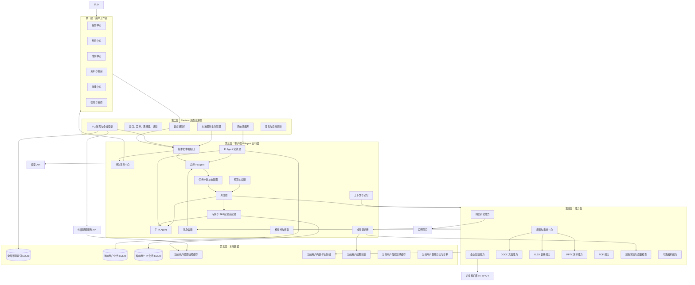
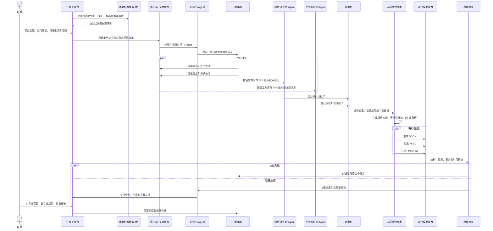

# tellhowBuddy 本地多智能体办公平台架构设计

- 日期：2026-08-14
- 状态：设计已确认，待文档评审
- 产品名称：tellhowBuddy
- 产品形态：个人版与企业版共用底座
- 执行方式：任务全部在用户电脑执行
- Agent 内核：开源 Pi `@earendil-works/pi-agent-core`

## 1. 产品目标

tellhowBuddy 是一款本地多智能体办公平台。用户通过自然语言下达任务，系统自主规划、并行检索资料、调用专业能力、生成办公文件、检查质量，并交付可直接验收的成果。

办公是产品主场景，首版重点为：

- 使用公开网页和企业服务端知识库完成资料检索、归纳和分析。
- 基于模板生成新的 DOCX、XLSX、PPTX 和 PDF 文件。
- 生成报告、数据表和汇报演示等多文件成果包。
- 对文件结构、视觉效果、事实、引用和跨文件一致性进行验证。

编码只是可选能力包，不属于通用底座。Git、终端、代码搜索和测试只在编码任务中加载。

## 2. 已确认的产品决策

| 决策项 | 结论 |
| --- | --- |
| 产品名称 | tellhowBuddy |
| 用户范围 | 同时支持个人用户和企业用户 |
| 任务执行位置 | 全部在用户电脑执行；电脑关机后暂停，重新打开后恢复 |
| Agent 内核 | 开源 Pi Agent Core，在客户端本地运行 |
| 会话存储 | 只保存在客户端，不通过外部配置接口同步 |
| 账号与数据隔离 | 登录成功后使用后端返回的稳定 `userId`；每个用户使用独立的 `workspace-{userId}` 数据工作区 |
| 首版资料来源 | 公开网页和公司服务端知识库 |
| 企业知识库现状 | 已有 HTTP API、用户登录和权限体系 |
| Office 依赖 | 不依赖用户安装 Microsoft Office |
| 首版文件能力 | 主要根据模板生成新文件，不承诺高保真修改复杂已有文件 |
| 首版成果格式 | DOCX、XLSX、PPTX、PDF |
| 多智能体方式 | 本地编排器创建多个 Pi Agent 实例，总控实例统一规划，子实例并行执行 |
| 内部架构 | 通用多智能体底座 + 可插拔能力包 |
| 外部配置接口 | 向客户端提供专家、Skills、提示词、模板、能力清单和策略的版本化配置 |

首版不包含：云端托管智能体、手机远程控制、跨设备同步、多人实时协作、完整 Office 编辑器、复杂已有 Office 文件的高保真往返编辑，以及企业知识库服务端重建。

## 3. Agent 内核与系统边界

tellhowBuddy 使用开源 [Pi](https://github.com/earendil-works/pi) 作为客户端 Agent 内核，核心包为 `@earendil-works/pi-agent-core`。Pi 提供 Agent 循环、流式事件、工具调用、工具执行前后钩子、并行或串行工具执行、steering/follow-up、上下文转换和可替换会话存储。

Pi Agent Core 负责单个 Agent 的模型与工具循环；tellhowBuddy 自己负责多 Agent 任务图、实例调度、专家配置装配、能力包路由、办公成果和产品状态。

| Pi 能力 | tellhowBuddy 使用方式 |
| --- | --- |
| `Agent` 与事件订阅 | 驱动总控和子 Agent，并把流式事件投影到客户端界面 |
| `AgentTool` | 将办公能力、网页研究和知识库连接器适配为 Pi 工具 |
| `beforeToolCall` | 在客户端执行确定性权限、资料分级和企业策略检查 |
| `afterToolCall` | 记录审计元数据、成果引用和质量结果 |
| `transformContext` / `convertToLlm` | 注入专家配置、Skills、证据片段和应用自定义消息 |
| steering / follow-up | 处理用户在任务运行中的调整和排队追加要求 |
| session backend | 使用客户端 SQLite 会话后端保存消息、分支、压缩和运行记录 |
| `parentSessionId` | 表达总控 Agent 与子 Agent 的父子会话关系 |

系统边界固定为：

- **客户端数据面**：运行 Pi Agent，保存会话、消息、任务、工具记录、检查点、证据缓存和办公成果。
- **外部配置接口**：向客户端提供专家、Skills、系统提示词、模板、能力清单、模型策略和组织策略的版本化快照。
- **外部企业知识接口**：提供已有知识库 HTTP API 和内容权限判断。

外部配置只以版本化快照进入客户端。任务创建时固定快照版本；任务运行期间即使外部推荐版本变化，也不能静默改变该任务的专家、Skills、提示词或模板。

## 4. 核心原则

1. **成果优先**：系统的最终交付物是可下载、可预览、可验证的办公成果，不是聊天文本。
2. **先保存，再执行**：需求、计划、资料、调用、权限、成果和检查结果必须持久化。
3. **事实单一来源**：报告、表格和演示使用同一证据包和指标定义。
4. **能力包隔离**：多智能体底座不理解具体文件格式；每个能力包独立声明输入、输出、权限和验证器。
5. **模型不拥有权限**：模型只能请求操作，本地策略引擎和企业服务端执行最终判断。
6. **不确定结果不盲目重试**：无法确认是否完成的外部操作先核验或询问用户。
7. **生成必须验证**：办公文件必须完成结构、视觉、事实和模板合规检查。
8. **个人与企业共用底座**：差异通过身份、策略、模板、连接器和审计适配器实现。
9. **会话只在客户端**：客户端不通过外部配置接口上传 Pi 会话正文、工具结果和成果文件。
10. **配置版本固定**：任务创建时固定专家、Skills、提示词、模板和策略版本，运行中不受外部推荐版本变化影响。

## 5. 总体架构



## 6. 产品子系统拆分

该产品规模不能由一个实施计划完成，应拆为以下可独立交付的子项目：

1. **桌面工作台**：任务、专家、成果、资料、技能、权限和设置界面。
2. **客户端 Pi Agent 运行层**：Pi 适配、任务计划、实例调度、消息、会话、事件和恢复。
3. **知识与研究系统**：网页研究、企业知识库连接器、证据包和引用。
4. **办公成果引擎**：DOCX、XLSX、PPTX、PDF、模板、素材、渲染和质量检查。
5. **配置接入与快照**：外部配置接口适配、签名校验、缓存、版本固定和兼容性处理。
6. **能力包平台**：客户端能力实现、外部能力清单适配、权限声明、版本管理和可选编码能力。

实施顺序应先建立多智能体底座和一种端到端成果格式，再逐步扩展其他文件类型。不能同时开发所有格式后再首次联调。

## 7. 用户工作台

### 7.1 任务中心

用户输入目标、选择交付格式和模板、指定资料范围、保存目录、联网权限和企业知识库范围。任务页展示计划、子智能体、进度、权限等待、引用和成果版本。

### 7.2 专家中心

专家是客户端通过外部配置接口取得的 Pi Agent 角色配置，声明适用场景、系统提示词、Skills、模型策略、能力包、权限、输入要求和输出验收标准。客户端展示已发布的专家目录；启动任务时下载并固定专家配置版本，然后装配为本地 Pi Agent 实例。

专家不是远程运行的 Agent，也不拥有远程会话；它只是客户端创建本地 Pi Agent 时使用的配置。首版建议提供：

- 综合报告专家
- 网页研究专家
- 企业知识分析专家
- 数据分析与表格专家
- 演示策划专家
- 文档排版专家
- 事实与引用审查专家
- 办公成果质量专家

### 7.3 成果中心

成果中心管理文件预览、版本比较、引用、质量报告、下载、删除和定向修改。用户可针对某页、某段、某个数字、某张表或某张幻灯片提出修改，系统只重跑受影响的任务链。

### 7.4 技能中心

Skill 是客户端通过外部配置接口取得的版本化任务方法和领域规则。客户端下载 Skill 内容并注入本地 Pi Agent 上下文；Skill 本身不直接获得系统权限，只能引导 Agent 使用客户端已安装且当前策略允许的能力包。

客户端缓存最近一次有效的专家与 Skill 配置快照，以支持离线查看和运行已固定配置的历史任务。离线状态下不能启动依赖未缓存配置的新任务。

## 8. 桌面与本地运行时边界

Electron 渲染进程不直接访问文件、凭据、知识库令牌和执行进程。桌面主进程通过 preload 暴露白名单系统能力，并负责启动本地多智能体服务。

本地服务只监听 `127.0.0.1`，每次启动生成临时认证密钥。桌面端和本地服务先完成协议版本、当前 `workspaceId`、Pi 版本、能力清单、数据库迁移和配置快照版本握手，再允许创建任务。

所有任务在本机执行。设备休眠或关机时任务停止；重新启动后只从安全检查点继续，不重复无法确认结果的外部操作。

会话正文、Pi 消息树、工具调用详情、任务检查点和办公成果只存客户端。客户端的外部配置适配器只实现配置下载，不实现会话或成果上传。

登录成功后，客户端用后端返回的稳定 `userId` 查找或创建 `workspace-{userId}`。切换账号前必须暂停当前任务、保存检查点、关闭当前用户的两个 SQLite、停止当前用户的 Agent 和事件订阅并清理内存上下文，然后才能打开新用户工作区。旧工作区数据保留在本机，但不能在新账号界面中显示或继续运行。

## 9. 客户端 Pi Agent 多智能体运行层

Pi Agent Core 提供单 Agent 循环。tellhowBuddy 的本地编排器在其上创建总控和子 Agent 实例，并维护任务依赖图。Pi 的并行工具调用不等于多 Agent；跨 Agent 并发、父子关系、预算和结果验收由 tellhowBuddy 负责。

### 9.1 总控智能体

总控 Agent 是一个使用总控专家配置装配的 Pi Agent 实例，负责理解用户目标、选择专家、拆分任务、定义验收标准、处理依赖、汇总结果和生成最终答复。总控 Agent 不直接实现具体办公格式。

### 9.2 任务计划与依赖图

计划使用有向无环图。每个子任务必须包含目标、输入、依赖、专家角色、能力包、资料范围、预算、权限、结构化输出和验收标准。计划修订必须产生新版本，已完成任务不会被隐式重跑。

### 9.3 调度器

只有在依赖完成、预算可用、并发槽位可用、权限满足且资源无冲突时，子任务才能运行。调度器为子任务选择固定版本的专家配置，创建带 `parentSessionId` 的 Pi 子会话，并装配对应 Pi Agent 实例。默认最多同时运行 4 个子 Agent。

### 9.4 配置装配器与消息信箱

外部配置接口是专家和 Skills 版本的权威来源；客户端配置缓存只保存已签名的不可变快照。配置装配器把专家系统提示词、Skill 内容、模型策略和工具白名单转换为 Pi `Agent` 的 `systemPrompt`、`model`、`tools` 和上下文转换函数。

任务记录必须保存所用专家、Skill、模板、策略和能力清单版本。消息信箱用于总控和子 Agent 之间的追问、结果上报和取消信号；消息进入对应 Pi 客户端会话，并拥有唯一标识和顺序号。

### 9.5 上下文与记忆

上下文按最小必要原则组装：任务目标、父任务摘要、证据片段、用户偏好、模板约束和能力说明。企业资料不能因子智能体并行而扩散给不需要该资料的任务。

记忆分为客户端当前任务记忆、客户端用户偏好，以及外部配置接口提供的企业规则和专家经验。企业规则优先级高于用户偏好。客户端记忆和用户会话不能回写到专家或 Skill 配置中。

## 10. 能力包协议

每个能力包必须提供统一清单。客户端从外部配置接口取得允许清单和启用策略，实际执行实现安装在客户端：

- 名称、版本、兼容协议和签名。
- 输入与输出结构定义。
- 所需权限、网络域名、文件范围和外部依赖。
- 可报告的进度、取消和超时行为。
- 幂等性与安全重试说明。
- 结构验证器、视觉验证器和业务验证器。
- 可消费和可生成的成果类型。

本地 Pi 工具适配器根据已固定的能力清单构造 `AgentTool`，并使用 `beforeToolCall` 做权限预检、使用 `afterToolCall` 记录结果。外部清单不能使客户端凭空获得未安装的执行能力，也不能绕过本地权限策略。

底座通过协议调用能力包，不导入能力包内部实现。首版可以在同一本地服务进程内加载内置信任能力；需要强隔离的第三方能力以后可迁移到独立工作进程。

## 11. 知识与研究系统

### 11.1 网页研究

网页能力负责搜索、打开、正文提取、发布日期识别、去重、可信度标记、快照摘要和引用链接。被拒绝访问或无法核验的网页必须标记证据缺口，不能由模型补写内容。

### 11.2 企业知识库连接器

企业知识库已具备 HTTP API、登录和权限体系。客户端携带当前用户令牌查询；服务端执行最终权限校验。客户端不下载完整知识库，只缓存当前任务使用的最小片段。

登录令牌存入系统凭据库。任务数据库只保存引用标识、必要摘要、权限等级、访问时间和内容哈希。缓存加密并设置过期时间。

### 11.3 证据包

网页和企业知识片段统一转为证据卡：

- 标题和摘要
- 原文片段或结构化数据
- 来源类型、链接或知识条目标识
- 作者、发布日期和访问时间
- 权限等级和可引用范围
- 内容哈希和引用编号
- 可信度、冲突和过期标记

报告、表格和演示都引用同一证据包，禁止分别生成互不一致的数据。

## 12. 办公成果引擎

### 12.1 首版边界

首版主要基于受支持的模板生成新文件，不承诺完整修改用户已有的复杂 Office 文件。用户上传模板时，系统先验证模板结构和支持范围。

客户端不依赖 Microsoft Office。每种格式拥有结构化内容模型、模板映射、文件生成器、解析验证器和渲染验证器。

### 12.2 DOCX 能力

支持封面、标题层级、目录、段落、列表、表格、图片、页眉页脚、分页、脚注和引用清单。生成后重新解析包结构，并渲染页面检查分页、溢出和缺图。

### 12.3 XLSX 能力

支持工作表、表头、数据区域、公式、条件格式、图表、冻结窗格、筛选和指标说明。生成后检查公式引用、数值类型、图表数据区域和可见性。

### 12.4 PPTX 能力

支持母版、版式、标题、正文、图表、图片、页码和演讲备注。生成前形成故事板，生成后逐页渲染检查文字溢出、重叠、裁切和留白。

### 12.5 PDF 能力

支持从受控布局直接生成 PDF，也支持把最终报告导出为固定版面文件。PDF 作为交付格式，不作为首版复杂编辑格式。

### 12.6 模板、素材和质量检查

模板定义内容槽位、重复区域、品牌规则、字体、色彩和必填章节。个人版可以使用本地模板或外部个人模板目录；企业版从外部配置接口获取已签名、已批准的模板版本。

素材中心记录图片、图标、图表和字体的来源、许可证和内容哈希。质量检查包含：文件可打开、结构完整、视觉无溢出、公式有效、必填内容完整、引用可追溯、跨文件关键事实一致。

## 13. 典型任务流程



## 14. 个人版与企业版

客户端分别接入外部配置服务 API 和企业知识库 API。前者提供版本化配置，后者提供内容检索和内容权限；两套接口使用独立身份范围，客户端不能用同一个万能令牌访问。本文不描述这些服务的内部架构、存储、部署或技术选型。

| 扩展点 | 个人版 | 企业版 |
| --- | --- | --- |
| 身份 | 本机或个人账号 | 企业统一登录和令牌刷新 |
| 模型 | 个人模型密钥 | 企业模型网关和允许模型清单 |
| 知识 | 网页和个人资料 | 网页 + 企业知识库 API |
| 策略 | 用户本机设置 | 组织策略优先于本机设置 |
| 专家与 Skills | 外部个人目录 | 外部组织目录和已审批版本 |
| 模板 | 个人本地模板或外部个人目录 | 外部配置接口提供的签名品牌模板和审批版本 |
| 能力包 | 用户自行安装 | 组织批准清单和签名校验 |
| 会话与成果 | 只保存在客户端 | 只保存在客户端 |
| 审计 | 本地诊断 | 默认保存在客户端；仅可按明确策略上报不含会话正文和成果内容的安全元数据 |

两种版本使用相同领域模型和本地执行引擎，不能维护两套任务系统。

## 15. 客户端持久化模型

客户端使用“全局账号索引 + 每用户独立数据工作区”。后端登录成功后必须返回稳定 `userId`；客户端不使用 token 作为数据库标识，也不给所有业务表重复添加 `userId`。

```text
客户端数据目录/
  global.db
  workspaces/
    workspace-{userId}/
      business.db
      pi-session.db
      config-cache/
      evidence-cache/
      artifacts/
      logs/
```

`workspace-{userId}` 是逻辑命名规则。写入文件系统前必须验证或安全编码 `userId`，禁止路径分隔符、相对路径和保留设备名。系统只允许连接一个登录环境，因此 `userId` 在该环境内必须全局唯一且长期稳定。

### 15.1 全局账号索引库

`global.db` 不保存用户会话和任务，只用于把登录身份映射到本地工作区，并保存设备级信息：

| 表 | 作用 |
| --- | --- |
| `account_profile` | 保存 `userId`、显示名称、头像、账号状态和最后登录时间；`userId` 唯一 |
| `workspace` | 保存 `userId`、工作区名称、目录、数据库版本、最后打开时间和锁定状态 |
| `device_capability` | 保存这台电脑实际安装的能力包、版本、签名、兼容范围和可用状态 |
| `app_setting` | 保存语言、主题、更新通道等与具体账号无关的设备设置 |

token 和模型密钥不进入 `global.db`，只存入系统凭据库，并使用工作区标识作为凭据索引。

### 15.2 每用户 Pi 会话库

每个 `workspace-{userId}` 拥有独立 `pi-session.db`。使用 Pi 的 SQLite session backend 保存会话元数据、父子关系、消息、分支、模型与工具变更、压缩摘要、operation/tool records、steering/follow-up 队列、用量和恢复信息。该库是当前用户会话的唯一权威来源。

### 15.3 每用户 tellhowBuddy 业务库

每个 `workspace-{userId}` 拥有独立 `business.db`。业务库记录“任务是怎样执行并产生成果的”，但不重复保存 Pi 会话正文。因为数据库文件已经按用户物理隔离，下面的业务表不再重复保存 `userId`：

| 表 | 一行代表什么 | 主要记录 | 在系统中的作用 |
| --- | --- | --- | --- |
| `workspace_metadata` | 当前数据库所属工作区的单行元数据 | `workspaceId`、`userId`、模式版本、创建时间 | 打开数据库时核对当前登录用户，防止把错误工作区挂载到运行时 |
| `task` | 一个主任务或子任务 | 父任务、目标、状态、计划版本、预算和验收条件 | 组成任务树，是调度器判断任务当前状态的权威表 |
| `task_dependency` | 两个任务之间的一条依赖边 | 前置任务、后置任务、依赖条件和创建时的计划版本 | 组成任务 DAG；只有前置条件满足，后置任务才可运行 |
| `agent_run` | 某个任务的一次 Agent 执行尝试 | `taskId`、Pi `sessionId`、专家版本、尝试次数、起止时间和运行状态 | 将业务任务关联到具体 Pi 会话；重试会新增记录，不覆盖旧运行 |
| `event` | 系统中已经发生的一件事 | 递增序号、事件类型、关联对象、时间和结构化载荷 | 形成只追加的任务时间线，供界面断线补发、诊断和状态追踪 |
| `config_snapshot` | 一个被任务固定的不可变配置包 | 专家、Skills、提示词、模板、策略、能力版本、哈希和签名 | 保证任务可复现；运行中的任务始终使用创建时的快照 |
| `tool_call` | Agent 提出并执行的一次工具调用 | `agentRunId`、输入摘要、幂等标识、权限状态、执行状态、结果引用和错误 | 判断调用是否完成、能否重试，以及外部副作用是否确定 |
| `permission_request` | 一次需要策略或用户决定的权限申请 | 关联工具调用、操作、资源范围、资料等级、风险、决定、决定者和时间 | 保存允许或拒绝的依据；同一工具调用可因范围变化产生新申请 |
| `evidence` | 一条可被引用的证据 | 产生任务、来源定位、摘录、内容哈希、权限、数据等级、时间和可信度 | 统一管理网页和知识库证据；原始大内容只保存文件引用 |
| `artifact` | 一个逻辑成果，例如“项目汇报 PPT” | 所属任务、成果类型、名称、状态、当前版本和导出位置 | 为用户提供稳定的成果标识；修改成果不会创建新的逻辑成果 |
| `artifact_version` | 某个成果的一次不可变版本 | 父版本、文件路径、内容哈希、模板版本、配置快照和质量结果 | 支持版本比较、回退和定向修改；新版本不能覆盖旧版本 |
| `artifact_evidence` | 一个成果版本对一条证据的引用关系 | `artifactVersionId`、`evidenceId`、引用位置和用途 | 说明文件中的数字或结论来自哪里，支持跨文件一致性检查 |
| `checkpoint` | 一次确认可恢复的执行边界 | `agentRunId`、已完成步骤、待执行步骤、状态引用和外部副作用状态 | 进程重启后只从安全位置继续，避免重复执行结果未知的操作 |

核心关系是：一个 `workspace_metadata` 对应当前用户的整个业务库；根 `task` 固定一个 `config_snapshot`，并可以拥有多个子 `task`；一个 `task` 可以有多次 `agent_run`；一次 `agent_run` 关联同一工作区中的 Pi 会话并产生多条 `tool_call`；任务产出的 `evidence` 被 `artifact_version` 通过 `artifact_evidence` 引用。调度器从全局 `device_capability` 核对本机能力，再结合当前任务的配置快照决定是否允许使用。`event` 记录这些对象的变化过程，`checkpoint` 只记录可以安全恢复的位置。

专家、Skills、系统提示词、模板和组织策略的权威版本由外部配置接口提供。客户端业务库只保存任务使用的不可变快照及校验结果，不提供这些配置的本地编辑功能。

### 15.4 账号切换与数据目录

扫码或其他方式登录成功后，客户端按 `userId` 查找 `global.db`：已有记录则重新打开对应工作区，没有记录则创建 `workspace-{userId}`。账号切换采用“先关闭旧工作区，再打开新工作区”的顺序；首版同一时刻只允许一个活动工作区和一组运行中的本地 Agent。

证据缓存、配置缓存、中间文件和默认成果目录均位于对应用户工作区。用户显式导出到工作区外部的文件不再由账号隔离机制管理，导出前必须展示目标路径并取得用户确认。

## 16. 本地协议

- HTTP JSON：创建任务、追加消息、回复权限、查询计划、查询成果和管理配置。
- SSE：按事件序号推送任务、智能体、资料、成果和权限事件。
- 本地文件流：预览和下载成果，不通过前端内存传输大文件。
- Electron IPC：文件选择、系统凭据、窗口、通知和更新等桌面专属能力。

所有创建、回复和成果确认接口都携带当前 `workspaceId` 和幂等请求标识。事件也携带 `workspaceId`；切换账号后，主进程和界面必须丢弃旧工作区迟到的事件。界面重连本地运行时携带当前工作区和最后事件序号，由本地运行时补发该工作区的缺失事件。

### 16.1 外部配置接口约定

客户端通过独立 HTTPS API 登录并同步专家目录、Skills、提示词、模板、能力清单和策略。响应必须包含配置 ID、版本、内容哈希、签名、发布时间、兼容客户端版本和依赖关系。

配置同步不得包含会话上传、任务消息上传或成果上传接口。运行中的任务通过 `config_snapshot` 固定版本；只有新任务或用户明确选择升级时才使用新配置。

## 17. 安全边界

- 渲染进程不拥有文件、凭据、知识库令牌和执行权限。
- 本地服务只监听本机地址，使用临时密钥并校验协议版本。
- 企业知识库每次查询由服务端执行最终权限校验。
- 资料按公开、内部、机密等等级决定是否可发送给模型或网页。
- 子智能体只接收完成子任务所需的最小资料片段。
- 企业策略控制模型、网页域名、能力包、模板和成果水印。
- 网页内容经过恶意内容隔离和提示注入检测，不直接成为系统指令。
- 文件写入只能发生在用户批准的成果目录。
- 模型和企业令牌只保存在系统凭据库，不进入提示词、数据库和日志。
- token 按 `workspaceId` 隔离保存；token 刷新不能创建新工作区，工作区归属只由稳定 `userId` 决定。
- 打开 `business.db` 和 `pi-session.db` 前必须校验目录名、`workspace_metadata.userId` 和当前登录 `userId` 一致。
- 能力包必须声明权限和版本；企业版可要求签名和批准清单。
- 日志自动脱敏密钥、令牌、个人信息和企业敏感原文。
- 专家、Skills、提示词、模板和策略快照必须校验外部签名、哈希和兼容版本。
- 外部配置适配器不得读取或上传客户端 Pi 会话库、业务库、证据缓存和成果目录。
- 配置同步遥测默认只包含版本、成功失败和客户端兼容性，不包含用户提示词、模型回复和工具输出。

## 18. 容错与恢复

| 故障 | 处理策略 |
| --- | --- |
| 界面关闭、电脑休眠或重启 | 保存任务和检查点；重新打开后从安全步骤继续 |
| 模型请求临时失败 | 指数退避；策略允许时切换备用模型并记录实际模型 |
| 单个办公文件生成失败 | 只重跑对应成果子任务，不重复研究和其他文件生成 |
| 文件质量检查失败 | 保留旧版本，创建定向修正任务 |
| 知识库登录过期或服务不可用 | 暂停依赖企业资料的任务，不用网页结果冒充企业资料 |
| 网页无法访问 | 标记证据缺口和低置信度，不编造来源 |
| 企业策略中途变化 | 下一次模型或能力调用前重新校验，停止不再允许的数据传递 |
| 磁盘不足或文件损坏 | 停止写入，保留临时成果，禁止覆盖最后有效版本 |
| 外部操作结果未知 | 禁止自动重复，先核验状态或请求用户决定 |

## 19. 测试策略

1. **任务底座测试**：依赖图、并发、幂等、取消、检查点、预算、消息和权限状态机。
2. **Pi 集成与会话测试**：Agent 事件顺序、工具钩子、父子会话、分支、压缩、steering/follow-up、SQLite session backend conformance 和崩溃恢复。
3. **账号隔离测试**：扫码登录、首次创建工作区、账号切换、token 刷新、旧事件丢弃、数据库误挂载拒绝和用户数据删除。
4. **配置快照测试**：签名、哈希、版本依赖、离线缓存、版本切换，以及外部推荐版本变化不影响运行中任务。
5. **连接器契约测试**：网页提取、知识库登录刷新、分页、权限拒绝、限流、引用和故障响应。
6. **办公文件结构测试**：DOCX、XLSX、PPTX、PDF 可解析，关系、公式、图片和模板字段完整。
7. **渲染与视觉测试**：页面截图检查溢出、重叠、空白、裁切、字体替换和分页变化。
8. **事实一致性测试**：报告、表格、PPT 的数字、结论、时间范围和引用来自同一证据包。
9. **安全测试**：越权查询、敏感资料外发、提示注入、路径逃逸、未签名配置、会话上传尝试和日志泄露。
10. **故障注入测试**：模型断流、配置服务断线、知识库断线、进程终止、磁盘不足、文件生成器异常和恢复。
11. **桌面端到端测试**：从登录和工作区切换、同步配置、创建本地 Pi 会话，到研究、多文件生成、质量检查、重启恢复、定向修改和下载。

模型行为测试使用可重复的录制响应或确定性测试提供器，不依赖在线模型随机输出判断核心正确性。

## 20. 推荐工程分层

```text
apps/desktop          Electron 主进程、preload 和用户工作台
apps/agent-runtime    客户端 Pi Agent 多智能体运行服务入口
packages/protocol     本机请求、响应、事件和版本协议
packages/domain       任务、配置快照、证据、成果、权限和状态机
packages/pi-runtime   Pi Agent、Pi 会话后端、事件和工具钩子适配
packages/orchestrator 总控 Pi Agent、计划、调度、消息和验收
packages/memory       上下文、摘要、用户偏好和企业规则
packages/capability   能力包协议、注册、签名和生命周期
packages/config-client 外部配置接口适配、签名校验和快照固定
packages/research     网页搜索、浏览、提取和引用
packages/knowledge    企业知识库 HTTP API 连接器
packages/artifacts    通用成果模型、版本和质量报告
packages/docx         DOCX 模板、生成和验证
packages/xlsx         XLSX 模板、公式、图表和验证
packages/pptx         PPTX 母版、生成和验证
packages/pdf          PDF 生成、合并和验证
packages/render       页面渲染、截图和视觉检查
packages/storage      SQLite、事件、检查点和内容存储
packages/identity     个人账号、企业登录和凭据适配
packages/policy       个人设置、企业策略和资料分级
packages/testing      录制模型、伪知识库、故障注入和测试夹具
packages/code-pack    可选编码能力，不被通用底座依赖

```

依赖方向必须保持 `protocol/domain -> application services -> infrastructure adapters`。领域层不得依赖 Electron、具体数据库、具体模型 SDK 或具体办公文件库。

## 21. 分阶段落地

1. **Pi 客户端骨架**：桌面进程边界、Pi Agent 适配、Pi SQLite 会话、本机协议和重启恢复。
2. **配置接入**：对接既有外部配置接口，完成客户端下载、签名校验、缓存、兼容检查和任务版本固定。
3. **研究闭环**：网页研究、企业知识库连接器、证据包、引用和资料权限。
4. **首个成果闭环**：先实现 DOCX 模板生成、渲染预览、质量检查和用户下载。
5. **多智能体闭环**：总控与子 Pi Agent、父子会话、依赖调度、并行研究和结果验收。
6. **多成果扩展**：增加 XLSX、PPTX、PDF，并实现跨文件事实一致性。
7. **个人与企业治理**：企业登录、策略、模型路由、能力签名和安全审计元数据。
8. **生态扩展**：更多连接器、设计创意、自动化和可选编码能力包。

## 22. 架构验收标准

- 编码能力关闭时，办公任务、知识研究和成果生成完全正常。
- 所有 Agent 运行均通过客户端 Pi Agent Core，不依赖远程 Agent 执行实例。
- Pi 会话、消息、工具结果、检查点和成果只保存在客户端，外部配置适配器不存在会话上传能力。
- 运行中任务固定专家、Skills、提示词、模板和策略版本，外部推荐版本变化不会改变其行为。
- 用户关闭客户端或重启电脑后，已确认任务状态和成果版本不丢失。
- 不同 `userId` 使用不同 `workspace-{userId}`；切换账号后不会显示、搜索、恢复或接收其他用户的会话、任务、证据和成果事件。
- 企业知识库权限不能被客户端、模型或能力包绕过。
- 未经允许的企业资料不能发送到网页或不允许的模型。
- DOCX、XLSX、PPTX、PDF 文件均可打开并通过结构验证。
- 所有最终文件经过渲染和视觉检查，不存在已知溢出、重叠和缺图。
- 报告、表格和演示中的关键事实、指标和引用保持一致。
- 用户可以针对单个成果或局部内容修改，不必重跑完整任务。
- 个人版和企业版共用同一任务、配置快照、证据和成果领域模型。
- 新能力包可以在不修改调度器和任务数据库结构的前提下接入。
