# SPX 考试前业务全流程图解

> 整理日期：2026-08-13\
> 业务范围：从培训计划开始，经过培训报名、班级、排课、考勤、学时、网培、国家平台培训报送、考试资格审批、约考，直到缴费及其异常处置；不展开正式考试实施、成绩、证书业务。\
> 定义来源：`output/` 下已有 11 份模块分析报告和全链路汇总报告。\
> 代码基线：当前工作树，HEAD 为 `0b2dc85ba6c39f0a07fb24e8087ad327aaec7deb`；同时复核当前未提交的报名关系起点调整。\
> 代码整理：使用当前 CodeGraph 索引（4,054 个文件、104,558 个符号）复核跨模块调用；OpenWiki 0.1.2 在无 Git/凭证的隔离源码快照中尝试运行，但因其工具调用被错误路由为 `functions.tool` 而未生成产物，因此未把 OpenWiki 输出作为业务证据。\
> 表达约定：流程图和正文使用中文业务状态；技术表名、类名只在“当前代码”或附录中保留，方便研发定位。

## 1. 文档说明

这份文档回答三个问题：

1. 学员从参加培训到完成缴费，中间到底经过哪些业务；
2. 每一步成功后，业务状态如何变化，失败后停在哪里；
3. 转班、移除、取消、删除、外部失败和支付异常会怎样影响主流程。

详细规则、代码证据和待确认事项仍以各模块报告为准。需要与产品经理逐题确认的规则见：`output/SPX业务流程产品经理必答问题清单.md`。

## 2. 考试前全链路

### 2.1 一张图看懂整个考试前流程

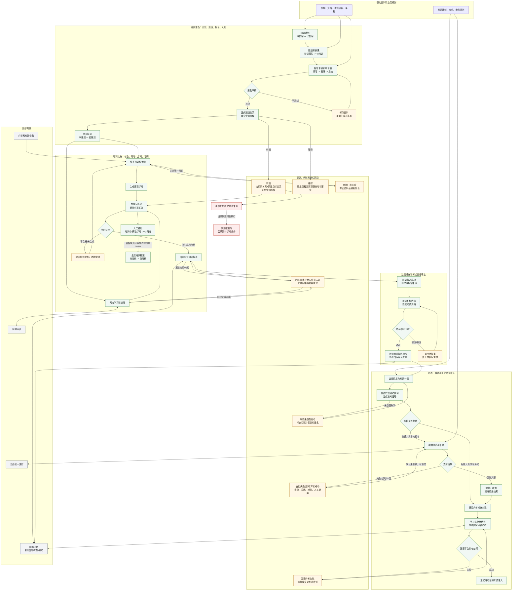

大白话说明：绿色是正常主流程，灰色是外部系统，黄色是业务回退和补偿，红色是当前代码已经确认的断链风险。整个流程真正传递的不是一个“学员状态”，而是一组逐步生成的业务对象：培训计划、班级和排课、报名和签署材料、正式班级关系与学习历程、课程学时、学时证明、培训档案、考试资格申请、考试报名资格、约考实例、支付订单以及国家平台约考结果。

这张总图有四个关键接力点：

| 接力点            | 上一阶段交付的事实           | 进入下一阶段的核心门槛                  |
| -------------- | ------------------- | ---------------------------- |
| 培训准备 -> 培训实施   | 审核通过的报名、正式班级关系、学习历程 | 班级可培训，学员正式在班，冲突同步已完成         |
| 培训实施 -> 监管报送   | 跨历史班累计后的学时证明        | 证明已生成且合格，正式关系有效，网培转班/删除任务无阻断 |
| 监管审批 -> 约考     | 最终审批通过后的考试报名资格      | 资格在有效期内、允许报名，考试计划已发布且容量可用    |
| 约考缴费 -> 正式考试准入 | 有效约考实例和已缴费/免缴事实     | 国家平台约考成功；支付成功本身不等于已经完成国家平台约考 |

总图中的回退不是“把状态改回去”这么简单：报名驳回要重新生成和签署材料；转班必须保留原班历史并沿用学习历程；外部结果未知要先查远端；支付异常成功要先解决入账或退款；已产生历史事实的对象应作废、终止或版本化更正，不能直接删除。

结班和归档在图中从学时证明并行收口，不作为考试资格审批的串行前置。当前归档代码只检查班级待归档、有效关系和合格学员证明生成率，并没有实际检查考试审批通过。

### 2.2 正常主链（简化版）

```mermaid
flowchart LR
    A["培训计划\n已备案且可使用"] --> B["创建班级与排课"]
    B --> C["培训报名\n签署并审核通过"]
    C --> D["正式入班\n建立学习历程"]
    D --> E["培训实施\n考勤与网培学习"]
    E --> F["生成课程学时"]
    F --> G["生成学时证明"]
    G --> H["国家平台培训报送"]
    H --> I["考试资格申请与审批"]
    I --> J["生成考试报名资格"]
    J --> K["选择考试计划并约考"]
    K --> L{"本次是否收费"}
    L -- "需要缴费" --> M["支付并完成入账"]
    L -- "免缴或同轮补考" --> N["满足国家平台约考前置"]
    M --> N
    N --> O["手工或免缴路径\n推送国家平台约考"]
    O --> P["国家平台约考成功\n取得正式考试准入"]
```

大白话说明：先有合法培训计划和班级，学员完成报名、签署、审核和正式入班后，才能形成考勤和学时。学时合格并完成国家平台培训报送后，进入考试资格审批；审批通过只代表“可以约考”，选定具体考试计划后才产生约考实例和缴费。收费场景支付成功后当前仍需通过其他入口手工推送国家平台，国网成功后才取得正式考试准入。

### 2.3 横向外部系统

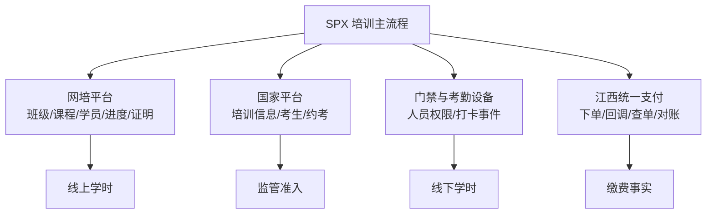

外部平台不是最后一步。它们分别穿插在建班、入班、培训、学时、资格审批、约考和缴费中。外部结果为“处理中”或“结果未知”时，不能简单当作成功或失败继续主流程。

## 3. 培训计划

### 3.1 创建、修改、报备和撤销

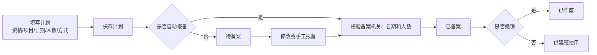

简单介绍：培训计划定义培训什么项目、培训方式、起止日期、计划人数以及课程学时要求。当前创建接口按 `autoReport` 决定保存后是否自动报备；也保留手工报备、修改、撤销和批量操作能力。

**状态文字：** 待备案、已备案、已作废；同时还有未关联班级、已关联班级两种使用状态。

### 3.2 计划被班级占用和释放

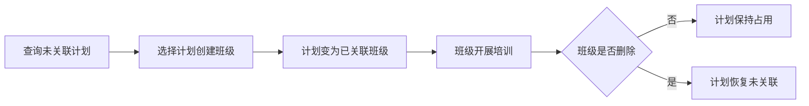

当前代码：`TrainingPlanServiceImpl` 提供新增并自动报备、修改、删除、撤销、批量操作和查询未关联计划。创建班级会占用计划，删除班级会释放计划。

当前注意：可建班主要看“未关联”，未完整限制为“已备案且未作废”；待备案计划删除也未完整检查班级引用。已产生历史班级后是否还能释放重用，必须按产品决策清单确认。

### 3.3 删除和批量操作

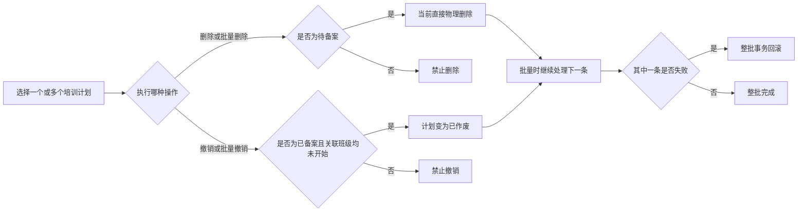

简单介绍：当前计划删除只检查“待备案”，随后物理删除，不检查是否已经被班级或历史业务引用；批量删除和批量撤销按顺序循环，一条失败会回滚整批。推荐规则是：只有从未被引用的纯草稿才能物理删除，一旦被使用只能作废保留。

**覆盖流程：** PLAN-F01 至 PLAN-F10、PLAN-S01。

## 4. 培训报名、申请表和审核

### 4.1 PC、APP 和批量导入报名

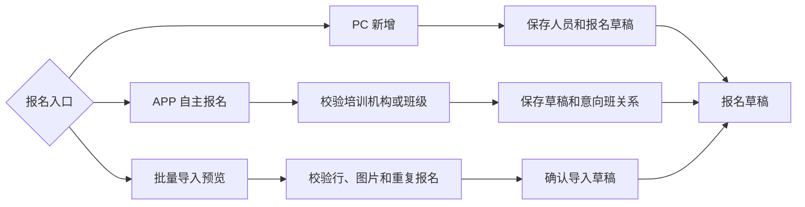

简单介绍：培训机构可以新增或批量导入报名，学员也可以在 APP 自主报名。三个入口最终都形成报名草稿；APP 选班还会建立意向班关系。

最新代码现状：当前工作树正在把普通入班关系起点调整为“不早于班级开始日”，避免开班当天加入的学员因时间边界丢失当日学时；APP 未选机构和班级、或机构不存在时也会阻断。

### 4.2 申请表签署、提交和审核

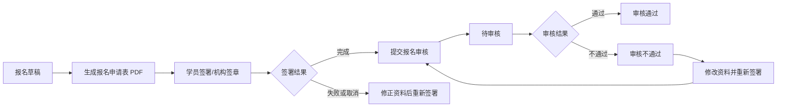

简单介绍：申请表签署是提交和审核的重要前置。正常流程是草稿生成 PDF、完成签署、提交待审核，审核通过后才能进入正式培训；驳回后修改资料会使旧材料失效并重新签署。

**状态文字：** 报名为草稿、待审核、审核通过、审核不通过；签署为未开始、准备中、签署中、已完成、失败、已取消。

### 4.3 审核通过、报到、剔除和再报名

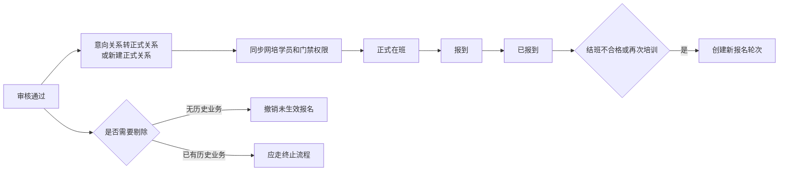

当前代码：审核通过会校验申请表和国家平台条件，并建立正式班级关系；报到目前主要检查未剔除和未报到；剔除主要检查当前正式关系。管理员可修改审核通过报名并重生成 PDF，但该路径未完整同步网培资料。

当前注意：草稿、待审核和审核不通过是否可能报到，意向班是否占名额，以及已有签署/报到/下游事实后如何剔除，均属于必须确认规则。

### 4.4 报名资料修改和重新签署

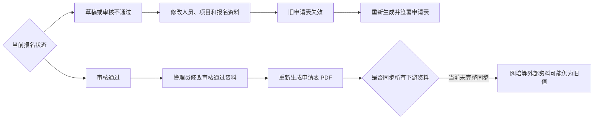

简单介绍：报名资料修改必须带着申请表版本一起处理。审核通过后的修改风险更高，因为班级、网培、国家平台或考试材料可能已经保存旧数据，不能只改本地人员字段。

**覆盖流程：** SIGNUP-F01 至 SIGNUP-F12、SIGNUP-S01、SIGNUP-S02。

## 5. 班级、入班、转班、移除和归档

### 5.1 创建班级和自动状态变化

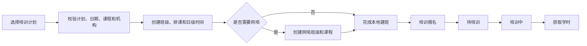

简单介绍：班级把培训计划真正落成可报名、排课和培训的载体。班级的前四个状态主要由日期自动计算；后续结班和归档由人工动作推进。

**状态文字：** 培训报名、待培训、培训中、获取学时、待归档、已归档。

### 5.2 正式入班

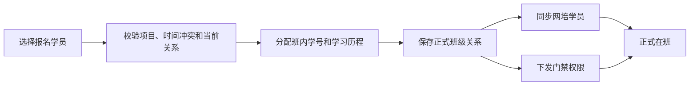

学习历程用于串联转班前后的同一轮培训。学员转班不会新建报名，也不会搬迁原班考勤和学时。

### 5.3 转班和撤销转班

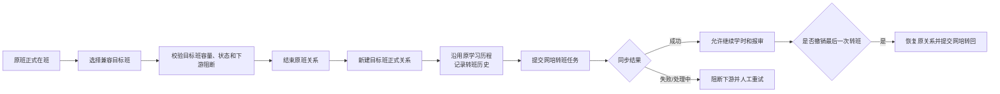

简单介绍：转班保留同一个报名和学习历程，原班培训事实原地保留，新班继续累计。撤销只针对最后一次可撤销转班，并保留反向操作记录。

### 5.4 移除学员和网培删除

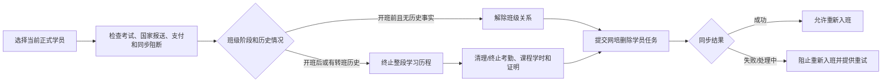

当前代码：开班后移除会物理删除课程学时并终止/逻辑删除部分培训事实。是否应改为作废保留，是产品经理必答问题。

### 5.5 结班、重训和归档

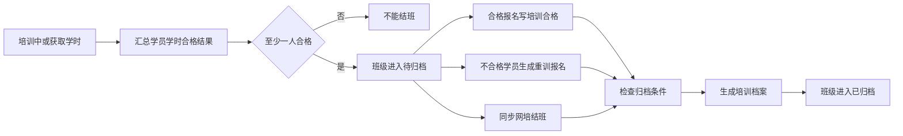

当前注意：结班允许在培训中提前执行，归档没有实际强制检查“考试审批通过”；归档后仍可修改部分高风险字段。正常结班、特批提前结班和归档冻结边界需要产品确认。

### 5.6 删除班级

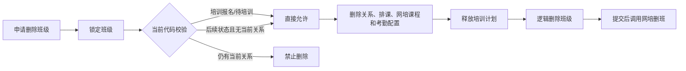

高风险说明：当前删除只看班级阶段和当前关系，没有检查转班、考勤、学时、证明、国家报送、考试、支付和归档历史。转班后删除原班会使历史学时聚合排除原班贡献。

### 5.7 外部班级报备写入

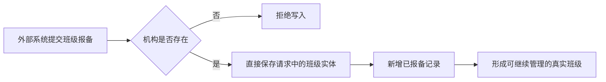

简单介绍：这是标注“测试使用”的开放写入口，不是培训机构页面的常规建班流程。当前仅校验机构存在，随后直接保存请求实体，绕过计划、日期、状态、课程、网培和计划占用等正常建班规则，但会产生后续流程能够读取的真实班级。

**覆盖流程：** CLASS-F01 至 CLASS-F15、CLASS-S01 至 CLASS-S03。

## 6. 课程主数据与班级排课

### 6.1 课程主数据

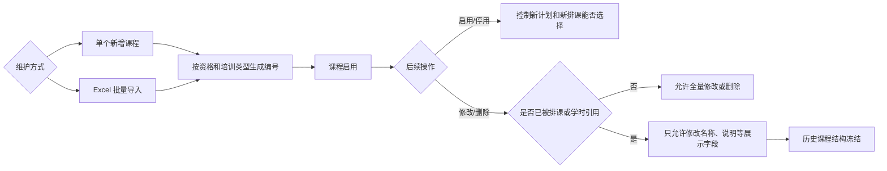

简单介绍：课程是排课和学时计算的稳定主数据。当前删除会锁项目并检查班级课程映射和学员课程学时引用；被使用后不能随意改变资格、培训类型和结构字段。

### 6.2 班级初始化排课、重排和培训中调整

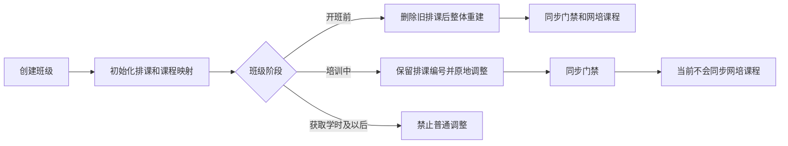

当前注意：培训中可以修改已发生的日期、时间和教师；教师时间冲突校验调用当前暂停。已有考勤或学时后修改排课，会重新解释历史。

**覆盖流程：** COURSE-F01 至 COURSE-F05、COURSE-S01、CURR-F01 至 CURR-F04、CURR-S01。

## 7. 考勤

### 7.1 考勤来源进入系统

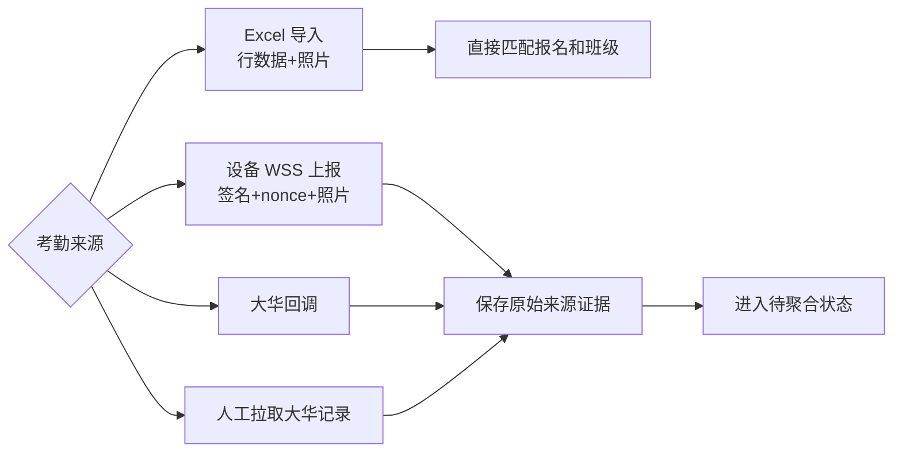

最新代码：Excel 图片处理已忽略“空壳图片”，避免没有有效图片内容时导入异常。Excel 的归班规则仍弱于设备和大华链路。

### 7.2 设备部署和唯一归班

```mermaid
flowchart LR
    A["新增或维护考勤设备"] --> B{"设备是否启用"}
    B -- "否" --> C["不参与新部署和采集"]
    B -- "是" --> D["部署到班级、教室和时间段"]
    D --> E["收到设备/大华事件"]
    E --> F["按机构、人员、正式关系、排课和部署筛选"]
    F --> G{"候选数量"}
    G -- "唯一" --> H["归到唯一班级和学习历程"]
    G -- "没有" --> I["聚合失败：无匹配"]
    G -- "多个" --> J["聚合失败：候选冲突"]
    H --> K["按来源唯一键生成标准考勤"]
```

简单介绍：设备和大华事件必须唯一归到某个机构、报名、班级、课程和学习历程。无候选或多候选时不应猜测，可在来源记录上重试聚合。

### 7.3 标准考勤转课程学时

```mermaid
flowchart LR
    A["标准考勤记录"] --> B["匹配课程排课和打卡窗口"]
    B --> C{"开始/结束打卡是否完整"}
    C -- "完整" --> D["课程考勤正常"]
    C -- "缺少一端或无有效打卡" --> E["课程考勤异常"]
    D --> F["生成有效课程学时"]
    E --> G["生成异常课程学时或不计入"]
    F --> H["进入学习历程汇总"]
```

当前注意：Excel 多候选可能取第一条并可覆盖其他来源标识；新考勤初始显示正常，但课程学时阶段可能判异常。归班和状态口径需要统一。

### 7.4 采集失败和重新聚合

```mermaid
flowchart LR
    A["WSS 聚合或设备事件处理失败"] --> B["保存失败原因和待处理记录"]
    B --> C["修正人员、设备或班级归属"]
    C --> D["人工或定时重新聚合"]
    D --> E{"本次是否成功"}
    E -- "是" --> F["生成标准考勤"]
    E -- "否" --> G["保留失败状态继续排查"]
```

简单介绍：采集失败不能直接丢弃，也不能在归属不清时强行生成考勤。修正基础资料后应从原始事件重算，并保留每次失败和重试记录。

**覆盖流程：** ATT-F01 至 ATT-F10、ATT-S01。

## 8. 学时与学时证明

### 8.1 生成已修课时

```mermaid
flowchart LR
    A["选择班级生成已修课时"] --> B["按考勤和排课清洗课程学时"]
    B --> C["按学习历程+课程编码跨历史班汇总"]
    C --> D["按当前班课程要求封顶"]
    D --> E{"是否包含网培"}
    E -- "是" --> F["查询当前班网培进度"]
    E -- "否" --> G["只计算线下学时"]
    F --> H["合并线上和线下学时"]
    G --> H
    H --> I["新增或更新当前学时汇总"]
```

简单介绍：线下学时来自考勤和排课；转班前后的线下学时按同一学习历程、同一课程编码累计，再按目标班课程要求封顶。线上学时只取当前班网培结果。

### 8.2 人工线上学时和学时证明生成

```mermaid
flowchart LR
    A["当前学时汇总"] --> B{"线上学时来源"}
    B -- "网培查询" --> C["写入网培线上学时"]
    B -- "人工补充" --> D["写入人工学时、来源和证明地址"]
    C --> E["判断总学时是否合格"]
    D --> E
    E -- "不合格" --> F["保留未生成证明"]
    E -- "合格" --> G["分配证明编号"]
    G --> H["获取/生成并上传证明文件"]
    H --> I["学时证明已生成"]
```

最新代码：证明生成失败时会尽量保留已有地址；空证明 URL 不再覆盖旧值，并支持流水号回填。

### 8.3 证明修复、重新获取和取消

```mermaid
flowchart LR
    A["学时证明记录"] --> B{"操作"}
    B -- "修复文件服务地址" --> C["重新上传已有证明"]
    B -- "按条件/全量重新获取网培证明" --> D["查询网培并返回逐项修复结果"]
    B -- "强制刷新" --> E["URL 未变化也重新上传"]
    B -- "取消证明" --> F["清空合格和已生成标记"]
    C --> G["更新证明文件地址"]
    D --> G
    E --> G
```

当前代码：`/hoursCert/repairNetTrainCertFileUrl` 支持按证明、班级、域名前缀筛选，也支持全量和强制刷新。取消证明仍只是局部清字段，没有实际复核考试申请阶段，也未完整联动国家报送和审批材料。

### 8.4 转班和移除对证明的影响

```mermaid
flowchart LR
    A["原班当前证明"] --> B{"关系变化"}
    B -- "转班" --> C["原班证明变为已替代"]
    C --> D["目标班形成新的当前证明"]
    D --> E["历史班课程学时继续累计"]
    B -- "移除" --> F["学习历程终止"]
    F --> G["证明终止并退出正常查询"]
```

高风险说明：跨班聚合要求历史来源班级未删除；删除转班原班会使旧班课程学时不再计入。

**状态文字：** 当前证明、已替代、已终止；未生成、已生成；合格、不合格；未归档、已归档。

**覆盖流程：** HOURS-F01 至 HOURS-F12，包括最新证明文件修复和全量重新获取能力。

## 9. 网培同步

### 9.1 建班、课程、学员和结班同步

```mermaid
flowchart LR
    A["培训方式为网络或混合"] --> B["解析培训机构与网培机构授权"]
    B --> C["创建网培班级"]
    C --> D["同步课程"]
    D --> E["新增/更新网培学员"]
    E --> F["查询进度和证明"]
    F --> G["本地结班"]
    G --> H["同步网培结班"]
```

当前代码：建班、加/改学员、开班前课程更新和结班使用名为 `runAfterCommit()` 的统一执行器，但默认行为实际加入当前事务；它们没有持久同步任务。

### 9.2 删除学员、转班和转回的持久任务

```mermaid
stateDiagram-v2
    [*] --> 待处理: 本地事务保存任务快照
    待处理 --> 处理中: 提交后认领任务
    处理中 --> 成功: 网培明确成功或幂等成功
    处理中 --> 失败: 网培失败或本地状态更新失败
    失败 --> 处理中: 人工重试
    待处理 --> 处理中: 超时接管
    处理中 --> 处理中: 悬挂任务超时接管
```

简单介绍：删除网培学员、转班和转回会保存请求快照和同步状态。任务成功前，系统会阻止学时、证明、国家培训报送、考试资格提交或重新入班等冲突操作。

### 9.3 删除网培班级

```mermaid
flowchart LR
    A["本地申请删除班级"] --> B["本地事务完成删班"]
    B --> C["事务提交后调用网培删班"]
    C --> D{"调用结果"}
    D -- "成功" --> E["本地和网培都已删除"]
    D -- "失败" --> F["只记录日志\n当前无持久任务"]
```

### 9.4 学员进入网培和查询学习结果

```mermaid
flowchart LR
    A["APP 学员查看可学习课程"] --> B["校验当前报名和网培机构映射"]
    B --> C["生成网培免登入口"]
    C --> D["学员在网培平台学习"]
    D --> E["SPX 查询学习进度和网培证明"]
    E --> F["合并线上学时并生成学时证明"]
```

简单介绍：APP 免登、课程查询、进度查询和证明查询共同组成线上学习闭环。授权映射不可用时，不应把“无法查询”误判为“没有学时”。

**覆盖流程：** NET-F01 至 NET-F12。

## 10. 国家平台培训信息报送

### 10.1 手工推送和子计划

```mermaid
flowchart LR
    A["学时页面选择班级和学员"] --> B["校验正式关系、已生成证明和同步状态"]
    B --> C["创建或复用国家平台子计划"]
    C --> D["构建班级培训数据"]
    D --> E["逐学员构建身份、照片、工作和学时资料"]
    E --> F["上传成功构建的学员子集"]
```

简单介绍：国家平台培训报送是学时页面的手工动作。系统为业务培训计划创建国家平台子计划，构建班级和学员资料后批量上传；单个学员资料构建失败不会阻止其他成功学员上传。

最新代码：复训报名会解析旧证，并在国家培训报送时上传旧证书标识。

### 10.2 报送状态、重试和考试申请创建

```mermaid
flowchart LR
    A["准备报送"] --> B["推送中"]
    B --> C{"远端结果"}
    C -- "明确成功" --> D["培训报送成功"]
    C -- "明确失败" --> E["培训报送失败"]
    C -- "超时/断网" --> F["当前代码也记为失败"]
    E --> G["再次手工推送"]
    F --> G
    G --> B
    D --> H["逐学员创建待报审考试资格申请"]
```

当前代码：配置关闭时不会调用平台，却会直接标记成功；远端成功与创建考试申请不是同一事务，可能出现“培训成功但申请缺失”。推送成功或推送中会阻止转班和移除。

**状态文字：** 未推送、推送中、成功、失败、结果未知；当前上传异常尚未真正使用“结果未知”。

**覆盖流程：** NAT-F01 至 NAT-F07、NAT-S01。

## 11. 考试资格申请与审批

### 11.1 候选、材料、内审和提交

```mermaid
flowchart LR
    A["国家培训成功并创建待报审申请"] --> B["查询可报审学员"]
    B --> C["查看报名表、课程、考勤和学时证明"]
    C --> D["培训机构内审"]
    D --> E{"内审结果"}
    E -- "通过" --> F["选择考试中心/考点并提交"]
    E -- "不通过" --> G["修正培训材料"]
    F --> H["待市局审批"]
```

简单介绍：考试资格申请是培训域到考试域的正式关口。候选列表按正式关系和合格证明筛选，材料页实时聚合报名、签署、课程、考勤和证明；培训机构内审后提交市局审批。

当前注意：真正提交接口没有完整复核候选列表中的合格证明、已生成证明、有效签署和内审条件，直接构造请求存在绕过空间。

### 11.2 撤回、市局/省厅审批和资格生成

```mermaid
flowchart LR
    A["待市局审批"] --> B{"市局处理"}
    B -- "驳回" --> C["市局驳回"]
    B -- "需省厅审批" --> D["待省厅审批"]
    B -- "市局终审通过" --> E["最终通过"]
    D --> F{"省厅处理"}
    F -- "驳回" --> G["省厅驳回"]
    F -- "通过" --> E
    A --> H["培训机构撤回"]
    D --> H
    H --> I["退回待报审"]
    E --> J["创建考试报名资格"]
    J --> K["同步国家平台考生"]
    K --> L{"后续是否需要更正"}
    L -- "否" --> M["保持有效资格"]
    L -- "修改考生" --> N["调用国家平台修改并记录结果"]
    L -- "删除考生" --> O["调用国家平台删除并记录结果"]
```

简单介绍：市局可以驳回、终审或流转省厅；省厅完成最终审批。通过后创建的是“待报名考试资格”，不是具体约考。国家平台考生同步失败会影响当前审批事务，外部成功、本地回滚仍存在不确定窗口。

最新代码：考试侧还提供国家平台考生修改和删除。删除成功只会删除国网考生信息，不删除本地申请、报名资格或约考数据，并把本地国家推送状态重置为“未推送”，以便后续重新推送。

**状态文字：** 待报审、待市局审批、待省厅审批、市局驳回、省厅驳回、最终通过。

**覆盖流程：** APPLY-F01 至 APPLY-F10、APPLY-S01。

## 12. 考试报名与约考

### 12.1 从考试资格到具体约考实例

```mermaid
flowchart LR
    A["考试报名资格：待报名"] --> B["查询已发布且匹配的考试计划"]
    B --> C["校验日期、容量、资格有效期和考试项目"]
    C --> D["国家平台黑名单和证书许可校验"]
    D --> E["根据历史实例计算初考/补考和轮次"]
    E --> F["生成准考证号"]
    F --> G["创建有效约考实例"]
    G --> H{"本次是否需要缴费"}
    H -- "需要" --> I["资格摘要：待缴费"]
    H -- "免缴" --> J["资格摘要：待出结果"]
```

简单介绍：考试资格审批通过后，学员还要选择具体考试计划。系统按历史有效实例自动判断初考、补考和轮次；普通特种作业人员每轮初考缴费，同轮补考免缴，主要负责人和安全管理人员免缴。

### 12.2 取消未缴费约考

```mermaid
flowchart LR
    A["待缴费的有效初考实例"] --> B["检查未缴费且无支付中订单"]
    B --> C["关闭已创建但未提交的支付订单"]
    C --> D["实例变为已取消"]
    D --> E["释放考试名额"]
    E --> F["资格恢复待报名"]
```

当前普通取消不支持已缴费、免缴或补考实例。国家平台取消约考是另一个独立操作，只重置远端推送状态，不等同于释放本地实例。

### 12.3 国家平台约考、失败重推和换考

```mermaid
flowchart LR
    A["有效且已缴费/免缴实例"] --> B["手工或免缴路径推送国家平台"]
    B --> C{"推送结果"}
    C -- "成功或已存在" --> D["国家平台约考成功"]
    C -- "失败" --> E["国家平台约考失败"]
    E --> F{"选择处理"}
    F -- "原计划重推" --> B
    F -- "变更考试计划" --> G["校验目标计划和当前状态"]
    G --> H["保留实例和支付事实\n生成新准考证"]
    H --> I["推送状态重置为未推送"]
    I --> B
```

最新代码：约考失败后可以变更考试计划，系统锁定实例和新旧计划，保留原支付订单和国家平台考生标识，记录变更历史并生成新准考证。换考目前不比较新旧考试收费金额。

### 12.4 准考证和考试准入

```mermaid
flowchart LR
    A["约考实例有效"] --> B{"国家平台约考是否成功"}
    B -- "成功" --> C["允许生成/下载正式准考证"]
    B -- "未成功" --> D["正式准考证禁止下载"]
    C --> E["进入考试实施"]
```

当前注意：正式准考证和考生分页要求国家平台成功，但部分实操候考池只检查实例有效且无成绩，准入口径仍不一致。

**状态文字：** 资格为待报名、待缴费、待出结果、合格、不合格；实例为有效、已取消、已过期；国家推送为未推送、推送中、成功、失败、结果未知。

**覆盖流程：** EXREG-F01 至 EXREG-F09、EXREG-S01、EXREG-S02。

## 13. 缴费

### 13.1 缴费规则和预览

```mermaid
flowchart LR
    A["维护缴费编码规则"] --> B{"规则类型"}
    B -- "一类特种作业" --> C["维护全局收费编码"]
    B -- "二类特种作业" --> D["按考试机构维护收费编码"]
    C --> E["启用或停用规则"]
    D --> E
    E --> F{"是否已有订单引用"}
    F -- "没有" --> G["允许修改或删除"]
    F -- "已有" --> H["当前仍可直接修改或删除"]
    H --> I["推荐改为停用或新版本\n保留历史订单快照"]
```

简单介绍：收费规则决定向江西统一支付提交哪个收费编码。当前代码没有反查使用中的订单，已使用规则仍可修改或删除；历史订单依靠订单明细和项目快照解释。推荐采用停用和新版本，避免新旧收费口径无痕混用。

缴费预览流程如下：

```mermaid
flowchart LR
    A["选择一个或多个待缴费约考实例"] --> B["加载考试、资格、人员和收费金额"]
    B --> C["解析缴费编码规则"]
    C --> D{"规则是否可用"}
    D -- "否" --> E["返回不可缴原因"]
    D -- "是" --> F["校验同一考试和同一收款规则"]
    F --> G["返回逐项金额和总金额"]
    G --> H["预览结束：不锁实例、不创建订单"]
```

简单介绍：一类特种作业项目使用全局收费编码，二类项目按考试机构匹配收费编码；金额来自考试计划。预览只计算和校验，正式下单会重新加载和重算。

### 13.2 正式下单和活动订单防重

```mermaid
flowchart LR
    A["正式下单"] --> B["按编号顺序锁定约考实例"]
    B --> C["检查实例有效且未缴费"]
    C --> D["锁定并查询已创建/支付中活动订单"]
    D --> E{"是否已有活动订单"}
    E -- "完全相同且同来源" --> F["复用原订单"]
    E -- "跨来源/金额/实例不一致" --> G["阻止新下单"]
    E -- "没有" --> H["创建本地订单、明细和收费快照"]
    H --> I["提交江西统一支付"]
```

最新代码：2026-08-12 已统一实例锁顺序，并对活动订单查询增加数据库行锁，降低并发重复创建订单和死锁风险。机构代缴与赣服通自缴共享同一实例互斥规则。

### 13.3 第三方下单结果和支付回调

```mermaid
flowchart LR
    A["本地订单已创建"] --> B["提交江西统一支付"]
    B --> C{"下单结果"}
    C -- "第三方受理" --> D["支付中\n返回支付地址"]
    C -- "明确拒绝" --> E["支付失败"]
    C -- "超时/网络异常" --> F["保持已创建\n下单结果待确认"]
    D --> G["第三方异步回调"]
    F --> H["等待回调或主动查单"]
    H --> G
    G --> I{"第三方是否成功"}
    I -- "成功且可入账" --> J["订单已支付\n实例已缴费"]
    I -- "成功但金额/实例冲突" --> K["异常成功"]
    I -- "明确失败" --> E
```

支付成功会写约考实例已缴费和入账订单号，考试资格摘要进入待出结果，并关闭重复活动订单、发送短信。当前支付成功后的国家平台约考调用已经显式移除，不会自动执行。

### 13.4 主动查单、补偿和迟到成功

```mermaid
flowchart LR
    A["已创建/支付中/近期已关闭订单"] --> B["人工刷新或定时补偿查单"]
    B --> C{"第三方结果"}
    C -- "成功且实例仍可入账" --> D["补记已支付"]
    C -- "成功但实例冲突" --> E["异常成功"]
    C -- "明确失败" --> F["支付失败"]
    C -- "待确认" --> G["保留活动或观察状态"]
    D --> H["逐明细更新实例和报名摘要"]
```

批量订单允许可处理明细先正常入账，冲突明细留给人工处理；因此“异常成功”可能代表整单冲突，也可能代表部分已经入账。

### 13.5 支付超时释放和异常关闭

```mermaid
flowchart LR
    A["活动支付订单"] --> B{"关闭原因"}
    B -- "支付超时" --> C["订单变为已关闭"]
    C --> D["未缴费有效实例变为已过期"]
    D --> E["释放考试名额并恢复可约考"]
    B -- "未返回支付地址" --> F["监管人员先主动查单"]
    F --> G{"确认第三方未成功且无支付流水"}
    G -- "满足" --> H["异常关闭本地订单"]
    H --> I["保留有效约考实例\n允许重新下单"]
    G -- "不满足" --> J["禁止关闭"]
```

最新代码：异常关闭只处理无支付地址、已查单且第三方非成功、无支付时间和流水、关联实例仍有效未缴费的订单；操作需要专用权限、必填原因并保存审计。它不是江西平台三方关单。

### 13.6 日终对账和人工处置

```mermaid
flowchart LR
    A["定时任务拉取前一日远端订单"] --> B["与本地订单逐笔比较"]
    B --> C["生成对账批次和差异"]
    C --> D{"差异类型"}
    D --> E["远端成功/本地失败或关闭"]
    D --> F["金额不一致"]
    D --> G["状态不一致或单边缺失"]
    E --> H["待处理"]
    F --> H
    G --> H
    H --> I["处理中"]
    I --> J["已处理或无需处理"]
```

当前没有线上退款和三方关单。差异处置状态只表示人工跟进进度，不能直接修改支付事实。

**状态文字：** 已创建、支付中、已支付、支付失败、已关闭、异常成功；人工处置为待处理、处理中、已处理、无需处理。

**覆盖流程：** PAY-F01 至 PAY-F11、PAY-S01、PAY-S02。

## 14. 跨流程撤销、删除和纠错

### 14.1 上游操作必须检查下游事实

```mermaid
flowchart LR
    A["准备修改/删除上游对象"] --> B{"是否已有历史或下游事实"}
    B -- "没有" --> C["允许撤销或删除草稿"]
    B -- "有" --> D["禁止普通删除"]
    D --> E["选择作废、终止、撤回、冲正或版本化更正"]
    E --> F["联动网培、国家平台、考试和支付"]
    F --> G["保留原因、操作者、前后值和历史记录"]
```

必须保护的上游对象包括培训计划、报名、班级、班级关系、排课、考勤、学时证明、考试资格和约考实例。

### 14.2 外部失败和结果未知

```mermaid
flowchart LR
    A["调用网培/国家平台/支付"] --> B{"结果"}
    B -- "明确成功" --> C["成功并允许下游"]
    B -- "明确失败" --> D["记录失败\n修正后重试"]
    B -- "超时/断网/响应不确定" --> E["结果未知"]
    E --> F["先查询远端事实"]
    F --> G{"查询结果"}
    G -- "成功" --> C
    G -- "失败" --> D
    G -- "仍未知" --> H["继续阻断冲突操作并人工处理"]
```

这是推荐的统一语义。当前网培、国家培训、国家约考和支付的状态实现还不完全一致：部分异常直接写失败，国家培训功能关闭甚至会写成功。

## 15. 关键状态总览

| 业务对象   | 主要中文状态                    | 状态说明                |
| ------ | ------------------------- | ------------------- |
| 培训计划   | 待备案、已备案、已作废               | 另有未关联班级、已关联班级       |
| 培训报名   | 草稿、待审核、审核通过、审核不通过         | 另有正常、已剔除；未报到、已报到    |
| 申请表    | 未开始、准备中、签署中、已完成、失败、已取消    | 资料变化后旧签署应失效         |
| 班级     | 培训报名、待培训、培训中、获取学时、待归档、已归档 | 前四态主要按日期变化          |
| 班级关系   | 意向报名、正式在班、已转出、已移除         | 学习历程串联转班历史          |
| 考勤来源   | 待聚合、聚合成功、聚合失败             | 标准考勤另有正常、异常         |
| 学时证明   | 当前、已替代、已终止；未生成、已生成；合格、不合格 | 多条并行状态不能混成一列        |
| 网培同步   | 待处理、处理中、成功、失败             | 转班/删除使用持久任务         |
| 国家培训报送 | 未推送、推送中、成功、失败、结果未知        | 当前异常路径尚未真正使用结果未知    |
| 考试资格申请 | 待报审、待市局审批、待省厅审批、最终通过、驳回   | 通过后生成考试报名资格         |
| 考试报名资格 | 待报名、待缴费、待出结果、合格、不合格       | 当前摘要，历史以实例为准        |
| 约考实例   | 有效、已取消、已过期                | 初考/补考、轮次、缴费和成绩属于实例  |
| 国家平台约考 | 未推送、推送中、成功、失败、结果未知        | 正式准考证要求成功           |
| 支付订单   | 已创建、支付中、已支付、支付失败、已关闭、异常成功 | 异常成功表示第三方已收款但本地存在冲突 |
| 对账差异   | 待处理、处理中、已处理、无需处理          | 只表示人工处置进度           |

## 16. 当前代码已确认的重点问题

### 16.1 转班原班删除导致历史学时丢失

```mermaid
sequenceDiagram
    participant A as 原班
    participant B as 新班
    participant H as 学时聚合
    participant D as 删除班级
    A->>H: 已产生课程学时
    A->>B: 转班后原关系结束
    D->>A: 当前关系为零，删除放行
    H->>A: 查询要求来源班级未删除
    A-->>H: 原班被排除
    H-->>B: 累计学时减少
```

### 16.2 支付成功不会自动推送国家平台约考

```mermaid
flowchart LR
    A["支付成功"] --> B["实例已缴费"]
    B --> C["报名摘要待出结果"]
    C --> D["发送短信"]
    D --> E["当前未创建国家平台约考任务"]
    E --> F["需要其他手工入口推送"]
```

### 16.3 异常成功对外显示为失败

```mermaid
flowchart LR
    A["第三方已经收款"] --> B["本地金额或实例冲突"]
    B --> C["内部状态：异常成功"]
    C --> D["对外投影：普通失败"]
    D --> E["用户可能再次缴费"]
    E --> F["当前无线上退款闭环"]
```

其他必须确认问题，包括考勤错归班、证明取消不联动、国家平台关闭假成功、资格提交绕过和已缴费换考差价，统一见 `output/SPX业务流程产品经理必答问题清单.md`。

## 17. 业务流程覆盖矩阵

| 模块        | 原模块流程编号                                                         | 本文对应章节 |
| --------- | --------------------------------------------------------------- | ------ |
| 培训计划      | PLAN-F01 至 PLAN-F10、PLAN-S01                                    | 第 3 章  |
| 培训报名      | SIGNUP-F01 至 SIGNUP-F12、SIGNUP-S01、SIGNUP-S02                   | 第 4 章  |
| 班级        | CLASS-F01 至 CLASS-F15、CLASS-S01 至 CLASS-S03                     | 第 5 章  |
| 课程与排课     | COURSE-F01 至 COURSE-F05、COURSE-S01、CURR-F01 至 CURR-F04、CURR-S01 | 第 6 章  |
| 考勤        | ATT-F01 至 ATT-F10、ATT-S01                                       | 第 7 章  |
| 学时与证明     | HOURS-F01 至 HOURS-F12                                           | 第 8 章  |
| 网培        | NET-F01 至 NET-F12                                               | 第 9 章  |
| 国家培训报送    | NAT-F01 至 NAT-F07、NAT-S01                                       | 第 10 章 |
| 考试资格申请与审批 | APPLY-F01 至 APPLY-F10、APPLY-S01                                 | 第 11 章 |
| 考试报名与约考   | EXREG-F01 至 EXREG-F09、EXREG-S01、EXREG-S02                       | 第 12 章 |
| 缴费        | PAY-F01 至 PAY-F11、PAY-S01、PAY-S02                               | 第 13 章 |

只读查询、导出、统计和详情能力没有逐个画成独立图，而是作为对应业务图的入口、结果和辅助说明合并表达；所有会改变业务状态、产生外部副作用或影响后续准入的流程均有独立流程图。

## 18. 详细文档索引

- `output/SPX考试报名前业务全链路规则汇总报告.md`
- `output/SPX业务流程产品经理必答问题清单.md`
- `output/培训计划模块业务流程与规则梳理报告.md`
- `output/培训报名模块业务流程与规则梳理报告.md`
- `output/班级模块业务流程与规则梳理报告.md`
- `output/课程与排课模块业务流程与规则梳理报告.md`
- `output/考勤管理模块业务流程与规则梳理报告.md`
- `output/学时与学时证明模块业务流程与规则梳理报告.md`
- `output/网培同步模块业务流程与规则梳理报告.md`
- `output/国家平台培训信息报送模块业务流程与规则梳理报告.md`
- `output/考试资格申请与审批模块业务流程与规则梳理报告.md`
- `output/考试报名与约考模块业务流程与规则梳理报告.md`
- `output/缴费模块业务流程与规则梳理报告.md`

## 19. 代表性当前代码入口

- 培训计划：`TrainingPlanController`、`TrainingPlanServiceImpl`
- 培训报名：`TraineeSignupController`、`TraineeSignupServiceImpl`
- 班级：`ClassController`、`ClassServiceImpl`、`ClassTransferServiceImpl`、`ClassTraineeRemovalServiceImpl`
- 课程排课：`CurriculumController`、`CurriculumServiceImpl`、`CourseServiceImpl`
- 考勤：`AttendanceDetailController`、`AttendanceDetailServiceImpl`、设备和大华聚合服务
- 学时证明：`HoursCertManageController`、`HoursCertServiceImpl`、`LearningJourneyHoursMapper.xml`
- 网培：`NetTrainIntegrationServiceImpl`、`NetTrainingSyncServiceImpl`、`NetTrainAfterCommitExecutor`
- 国家培训：`NationalTrainingInfoUploadService`、`NationalTrainingPlanService`
- 考试资格：两侧 `ExamApplyTraineeController`、`ExamApplyTraineeServiceImpl`
- 约考：两侧 `ExamSignupController`、考试侧 `ExamSignupService`、`ExamSignupNationalService`
- 缴费：`PayJiangxiController`、`PayOrderServiceImpl`、`ActiveOrderGuardServiceImpl`、`PaymentStateTransitionServiceImpl`、`PayBillServiceImpl`、`PayReconciliationServiceImpl`

