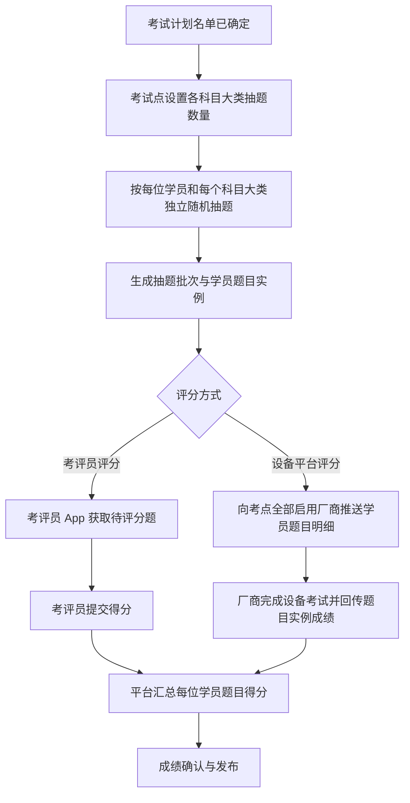

# 实操考试抽题与设备成绩接入需求设计 V2.0

| 项目 | 内容 |
| --- | --- |
| 版本 | V2.0 |
| 日期 | 2026-07-20 |
| 适用范围 | 实操考题管理、实操抽题管理、考评员 App、设备厂商接入 |
| 替代范围 | 替代原“实操随机抽题审核与评分方式需求设计”和“实操设备成绩接入需求设计”中的抽题审核、题库厂商映射及设备调度方案 |

## 1. 背景与目标

实操考试的抽题对象由考试计划调整为考试计划内的每位学员。系统应针对每名学员、每个科目大类，按该大类配置的数量独立随机抽取考题。不同学员可抽到相同考题。

取消考试中心和发证机关的审核流程。抽题完成后立即生效，并为每名学员的每道抽中考题创建唯一的题目实例。

平台不管理设备库存、设备可用状态、设备排队或设备调度；考生使用哪台设备以及设备厂商的内部业务由厂商平台负责。平台仅识别题目采用考评员评分还是设备平台评分，并主动将设备评分题推送给考点已启用的全部厂商。厂商通过接口回传其实际完成的学员题目成绩。

## 2. 范围与非目标

### 2.1 本期范围

- 实操考题仅配置评分方式。
- 按“学员 x 科目大类”批量随机抽题。
- 按“学员 x 抽中考题”创建题目实例。
- 考评员 App 对人工评分题录入成绩。
- 平台主动向厂商推送设备评分题，厂商回传按题目实例归属的成绩。
- 平台级实操厂商信息与考试点级考点厂商管理。
- 厂商推送、成绩回传、重试和异常处理日志。

### 2.2 非目标

- 不维护厂商题目编码、厂商与考题映射、设备题组或设备编号。
- 不维护设备可用状态、设备占用、设备排队和考生设备分配。
- 不改造厂商内部题目展示、评分逻辑、设备控制和排队流程。
- 不设置考试中心审核、发证机关审核、驳回、审核意见或审核状态。
- 考试计划抽题完成后不支持考生名单变更。

## 3. 角色与权限

| 角色 | 数据范围与权限 |
| --- | --- |
| 考试点考务人员 | 查询本考试点计划；发起抽题；查看结果；开考前整场重新抽题；维护本考试点实操平台配置。 |
| 考评员 | 仅在 App 中查看被分配学员的考评员评分题，并提交评分。 |
| 平台管理员 | 维护实操平台配置和全局接入日志。 |
| 实操设备平台 | 仅以自身鉴权身份接收平台推送、回传平台成绩；无后台业务操作权限。 |

后端必须基于登录身份、机构数据范围和题目实例的评分方式校验权限，不以页面按钮显隐作为权限依据。

## 4. 业务规则

### 4.1 抽题规则

1. 抽题前提：考试计划已确定且考生名单固定。
2. 抽题维度：系统遍历计划内每名学员，再按每个科目大类的配置数量独立随机抽题。
3. 同一学员同一科目大类内不得抽到重复题；不同学员之间允许抽到相同题。
4. 候选考题必须已启用、未删除、操作项目和科目大类匹配，且评分方式完整。
5. 某科目大类的配置数量必须为大于 0 的整数，且不得超过该类可用考题数；否则整场抽题不得开始。
6. 抽题成功即生效，不存在提交审核、待审核或审核通过状态。
7. 系统保留抽题批次、随机凭据和操作记录，用于审计追溯；该记录不是业务审核流程。
8. 任一学员已有已开始、已评分或已接收设备成绩的题目实例时，不允许整场重新抽题。
9. 开考前可整场重新抽题。系统作废旧批次及其未完成题目实例，再基于固定名单生成新批次；旧记录保留且不可再次评分。

### 4.2 评分方式

| 值 | 名称 | 处理方式 |
| --- | --- | --- |
| `MANUAL_APP` | 考评员评分 | 题目实例进入考评员 App，由考评员按评分项录入成绩。 |
| `DEVICE_PLATFORM` | 设备平台评分 | 题目实例由平台主动推送至考点全部启用厂商，成绩仅由厂商接口写入。 |

题库中不再配置设备厂商、厂商题目编码、设备题组、设备编号、设备状态等字段。评分方式、题目内容、满分和评分项在抽题时写入题目实例快照，后续题库修改不得影响已抽题考试。

### 4.3 厂商推送与回传

1. 抽题成功后，对每道设备平台评分题，平台向该考试点全部已启用厂商接入配置推送考试计划、学员及题目明细。
2. 推送最小颗粒度为“一个学员的一道题目实例”；厂商收到的数据必须含题目实例 ID。
3. 厂商在自身平台完成实际考试后，回传题目实例 ID、厂商成绩流水号、得分、满分、完成时间和结果状态。
4. 一条题目实例只允许一条正式设备成绩。厂商同一成绩流水号的重复回传按幂等成功处理。
5. 不同厂商回传同一题目实例，属于重复考试或错误回传，不属于正常成绩竞争。平台拒绝第二条回传并记录接口异常，不覆盖已接收成绩。
6. 厂商只能回传设备平台评分题；考评员 App 只能提交考评员评分题，两类入口不可互相覆盖。
7. 推送失败可按厂商和题目实例重试；成绩回传失败或不合法不写入正式成绩。

## 5. 端到端流程

## 6. 页面设计

### 6.1 菜单结构

实操相关功能统一归入“实操考试管理”一级分组，菜单顺序为：实操考题管理、实操抽题管理、实操平台配置、考点实操平台配置。

“实操平台配置”和“考点实操平台配置”为两个独立菜单，不再使用合并菜单或内部页签切换。

### 6.2 实操考题管理

沿用现有“查询条件 + 列表 + 新增/编辑弹窗”结构。

- 查询条件与列表新增“评分方式”。
- 新增/编辑弹窗的“评分方式”为必填单选项：考评员评分、设备平台评分。
- 删除设备厂商、厂商题目编码、设备题组、设备编号等全部厂商相关表单项和列表列。
- 已进入当前抽题批次的考题不直接影响历史题目实例；编辑后仅用于后续抽题。

### 6.3 实操抽题管理

菜单保留“实操抽题管理”，删除原独立“考题审核”菜单及所有审核入口。

列表按考试计划展示：考试计划名称、操作项目、考试点、考试日期、考生人数、抽题进度、最近抽题时间、操作人、操作。

操作规则：

| 条件 | 可执行操作 |
| --- | --- |
| 尚未抽题 | 开始抽题 |
| 已抽题且无人开始考试、无人有成绩 | 查看抽题结果、重新抽题 |
| 存在已开始、已评分或已接收成绩的题目实例 | 查看抽题结果 |

“开始抽题/重新抽题”弹窗展示考试计划、固定考生人数，以及按科目大类维护的抽题数量。执行抽题后，系统一次性完成所有学员的抽题，不需针对每名学员人工点击十次。

“抽题结果”页按学员展开，展示学员姓名、证件号脱敏信息、各科目大类、抽中题目、评分方式和题目实例 ID。页面不展示审核状态、审核意见或审核处理记录。

### 6.4 实操平台配置

平台管理员维护实操设备平台的调用地址：平台名称、平台接口地址、启停状态、备注和最近联调结果。不维护平台编码、回调地址、鉴权方式、签名密钥、厂商业务资料、联系人、设备信息或厂商题目映射。

支持新增、编辑、停用、启用和查看接口记录。点击“查看接口记录”后，以弹窗列表展示该实操平台的推送、回传、幂等和拒收记录。接口停用后，不再接收新的题目推送；历史推送与成绩记录仍可查询。

### 6.5 考点实操平台配置

考试点管理员直接维护本考试点启用的实操平台接口，不经过申报或审核。字段包括：考试点、实操平台、启停状态、备注。

同一考试点可启用多个实操平台接口。抽题完成后，平台向该考试点所有启用接口推送设备评分题。此页面不维护设备、设备可用状态、厂商与考题映射或考生分配。

## 7. 数据设计

### 7.1 抽题批次 `practical_draw_batch`

| 字段 | 说明 |
| --- | --- |
| `drawBatchId` | 抽题批次 ID |
| `examPlanId` | 考试计划 ID |
| `candidateCountSnapshot` | 抽题时考生人数快照 |
| `isCurrent` | 是否当前生效批次 |
| `randomSeedHash` | 随机凭据摘要 |
| `drawnBy` / `drawnAt` | 操作人及时间 |
| `invalidatedBy` / `invalidatedAt` | 重抽时的作废信息 |

### 7.2 学员抽题结果 `candidate_practical_draw_result`

| 字段 | 说明 |
| --- | --- |
| `drawResultId` | 结果 ID |
| `drawBatchId` | 所属抽题批次 |
| `candidateSignupId` | 学员报名实例 ID |
| `subjectCategoryCode` | 科目大类 |
| `drawCount` | 本学员本大类抽题数量 |
| `practicalQuestionId` | 抽中考题 ID |
| `questionSnapshot` | 考题内容、满分、评分项快照 |
| `scoreSourceSnapshot` | 评分方式快照 |

### 7.3 学员题目实例 `candidate_practical_question_instance`

| 字段 | 说明 |
| --- | --- |
| `questionInstanceId` | 全局唯一题目实例 ID；厂商回传的核心归属键 |
| `examPlanId` / `candidateSignupId` | 所属考试计划和学员 |
| `drawResultId` | 对应抽题结果 |
| `scoreSource` | 评分方式快照 |
| `fullScore` | 满分快照 |
| `instanceStatus` | 待考、考试中、待评分、已评分、已作废等 |
| `officialScore` | 正式得分 |
| `scoreRecordedAt` | 正式成绩写入时间 |

### 7.4 厂商与接入记录

| 对象 | 核心字段 |
| --- | --- |
| `practical_platform_config` | 平台名称、平台接口地址、启停状态 |
| `exam_point_platform_config` | 考试点、实操平台、启停状态 |
| `vendor_question_dispatch` | 题目实例、厂商、推送状态、重试次数、请求/响应摘要 |
| `vendor_score_receipt` | 厂商、成绩流水号、题目实例、得分、完成时间、处理状态、拒收原因 |

数据唯一性要求：`questionInstanceId` 在所有正式设备成绩中唯一；`vendorId + vendorScoreEventNo` 在厂商回传记录中唯一。

## 8. 接口设计

### 8.1 平台推送厂商题目

平台按厂商批量调用推送接口，单条记录至少包含：

| 字段 | 说明 |
| --- | --- |
| `questionInstanceId` | 学员题目实例唯一 ID |
| `examPlanId` / `examPlanName` | 考试计划标识和名称 |
| `examPointId` / `vendorExamPointCode` | 平台考点和厂商侧考点标识 |
| `candidateId` / `candidateName` / `idCardNo` | 学员身份信息；证件号按接口安全规范传输 |
| `subjectCategoryCode` | 科目大类 |
| `questionCode` / `questionContent` | 平台考题标识及题目内容快照 |
| `fullScore` | 满分 |
| `examStartTime` / `examEndTime` | 计划考试时间范围 |

推送接口采用 HTTPS 和厂商级鉴权签名。平台记录每一题、每一厂商的请求结果，失败记录可重试，不影响已成功推送的其他厂商。

### 8.2 厂商回传成绩

厂商回传至少包含：

| 字段 | 说明 |
| --- | --- |
| `questionInstanceId` | 必填，定位唯一学员题目实例 |
| `vendorScoreEventNo` | 必填，厂商成绩流水号，幂等键 |
| `score` / `maxScore` | 必填，实际得分与满分 |
| `completedAt` | 必填，完成时间 |
| `resultStatus` | 必填，完成、缺考、设备故障、成绩无效等 |
| `evidenceUrl` | 可选，设备日志、照片或视频凭据地址 |

接口处理顺序：鉴权厂商身份 -> 校验题目实例存在且为设备平台评分 -> 校验满分和分数范围 -> 校验厂商成绩流水幂等 -> 写入正式成绩或拒收原因。

## 9. 异常规则

| 场景 | 处理规则 |
| --- | --- |
| 候选题不足或题目评分方式缺失 | 禁止整场抽题，提示具体科目大类和缺失项。 |
| 设备评分题存在但考点无启用平台接口 | 禁止抽题，提示先维护考点实操平台配置。 |
| 厂商题目推送失败 | 记录失败并自动/人工重试；按单厂商、单题目实例重试。 |
| 厂商回传不存在、作废或人工评分的题目实例 | 拒收并记录接口异常。 |
| 分数超范围或满分不一致 | 拒收并记录接口异常。 |
| 同一厂商重复回传同一成绩流水 | 幂等返回成功，不重复写入成绩。 |
| 不同厂商回传同一题目实例 | 拒收后到达记录，保留接口日志，不覆盖正式成绩。 |
| 已有学员开始考试或已有成绩后重抽 | 禁止重抽，提示当前批次已进入考试。 |

## 10. 验收标准

1. 考试计划有 10 名学员时，系统可一次性按每名学员、每个科目大类完成独立抽题；不同学员允许抽到相同考题。
2. 每位学员每个科目大类的抽题数量严格等于该类配置数量，同一学员同一大类不重复抽题。
3. 系统不展示也不校验考试中心审核、发证机关审核、审核意见和审核状态；抽题完成立即生效。
4. 每道抽中考题均生成唯一题目实例 ID，且可准确关联考试计划、学员、科目大类、题目和评分方式快照。
5. 考评员 App 仅展示并可提交考评员评分题；设备厂商接口仅可写入设备平台评分题。
6. 设备评分题向该考试点全部已启用厂商推送，推送明细包含每位学员每道题的题目实例 ID。
7. 厂商以题目实例 ID 回传成绩后，平台可准确写入对应学员、对应题目，不依赖姓名、证件号或科目大类猜测归属。
8. 不同厂商回传同一题目实例时，后到记录被拒收，不覆盖正式成绩。
9. 平台管理员可维护实操平台配置，考试点可直接维护考点实操平台配置；两类维护均不包含设备调度和厂商考题映射。
10. 抽题、重抽、厂商推送、回传、拒收和重试均有可查询的操作或接口日志。
