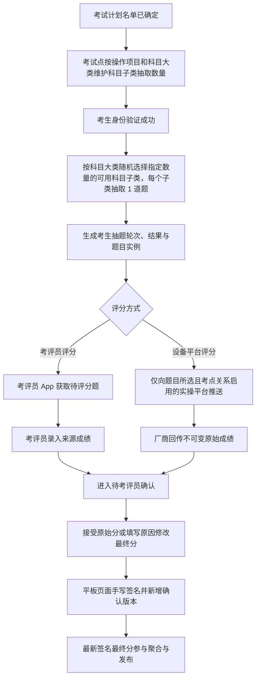

# 实操考试抽题与设备成绩接入需求设计 V2.0

| 项目 | 内容 |
| --- | --- |
| 版本 | V2.0 |
| 日期 | 2026-07-20 |
| 适用范围 | 实操考题管理、抽题设置、考评员 App、实操平台接入 |
| 替代范围 | 替代原“实操随机抽题审核与评分方式需求设计”和“实操设备成绩接入需求设计”中的抽题审核、题库厂商映射及设备调度方案 |

## 1. 背景与目标

实操考试的抽题对象由考试计划调整为考试计划内的每位考生。考试计划确认后，考生名单固定。考生每次身份验证成功后，系统针对该考生，按考试点、操作项目和已启用科目大类设置的科目子类抽取数量，先随机选择符合条件的科目子类，再从每个选中子类随机抽取 1 道考题。不同考生可抽到相同考题。

实操抽题流程取消考试中心和发证机关的审核流程。考生抽题轮次生成后立即生效，并为该考生的每道抽中考题创建唯一的题目实例。

平台不管理设备库存、设备可用状态、设备排队或设备调度；考生使用哪台设备以及实操平台厂商的内部业务由实操平台负责。每道设备平台评分题必须从实操平台主配置中选择且仅选择一个实操平台，抽题后仅向该题所选且在当前考点已启用的实操平台推送。实操平台通过接口回传其实际完成的学员题目原始成绩；该值不可修改，回传成功后状态为“待考评员确认”，不能直接成为最终成绩。

## 2. 范围与非目标

### 2.1 本期范围

- 实操考题配置评分方式、考试时长和题型；考试时长以分钟计，为必填正整数，题型为必填项“新考题”或“旧考题”。
- 考试点按操作项目和科目大类维护身份验证触发的科目子类抽取数量；身份验证成功后，按“考生 x 科目大类”随机选择指定数量的符合条件科目子类，并从每个选中子类抽取 1 道考题。
- 按“考生 x 抽中考题”创建题目实例。
- 考评员平板端 App 对人工评分题录入来源成绩，并对实操成绩进行确认。
- 平台按考题所选实操平台定向推送设备评分题，实操平台回传按题目实例归属的不可变原始成绩。
- 考评员可在平板端接受来源成绩或修改最终成绩；修改必须填写原因，每次确认或再次确认均须在平板页面完成手写签名并新增确认版本。
- 平台级实操厂商信息与考试点级考点厂商管理。
- 厂商推送、成绩回传、重试和异常处理日志。

### 2.2 非目标

- 不维护厂商题目编码、厂商与考题映射、设备题组或设备编号。
- 不维护设备可用状态、设备占用、设备排队和考生设备分配。
- 不改造厂商内部题目展示、评分逻辑、设备控制和排队流程。
- 实操抽题流程及“抽题设置”页面不设置考试中心审核、发证机关审核、驳回、审核意见或审核状态。
- 考试计划确认后不支持考生名单变更。

## 3. 角色与权限

| 角色 | 数据范围与权限 |
| --- | --- |
| 考试点考务人员 | 查询本考试点计划、考生身份验证和抽题结果；查看抽题结果及状态；维护本考试点实操考题、抽题设置和实操平台配置；提交考题新增、修改、停用申请。 |
| 地市考试中心审核人员 | 审核本地市考试点提交的实操考题新增、修改和停用申请。 |
| 地市发证机关审核人员 | 审核经地市考试中心通过的实操考题申请，审核通过后使申请生效。 |
| 考评员 | 在考评员平板端 App 中查看被分配学员的考评员评分题并录入来源成绩；查看设备原始成绩；接受来源成绩或填写原因后修改最终成绩；每次确认、修改或再次确认前在平板页面完成手写签名。后台管理端不提供这些操作。 |
| 平台管理员 | 维护实操平台配置和全局接入日志。 |
| 实操设备平台 | 仅以自身鉴权身份接收平台推送、回传设备原始成绩；无后台业务操作或最终成绩写入权限。 |

后端必须基于登录身份、机构数据范围和题目实例的评分方式校验权限，不以页面按钮显隐作为权限依据。

## 4. 业务规则

### 4.1 抽题规则

1. 抽题前提：考试计划已确定且考生名单固定。
2. 抽题维度：考生身份验证成功后，系统针对该考生，读取其考试点、操作项目下已启用的科目大类抽题设置；按每个科目大类设置的科目子类抽取数量，从符合候选条件且至少有 1 道可用考题的科目子类中不重复随机选择，再从每个选中子类随机抽取恰好 1 道考题，并生成一个考生抽题轮次。
3. 同一考生同一科目大类、同一抽题轮次内不得重复选择科目子类，也不得抽到重复题；不同考生之间允许抽到相同科目子类和考题。
4. 候选考题必须已启用、未停用、操作项目、科目大类和科目小类匹配，且评分方式、考试时长和题型完整。`DEVICE_PLATFORM` 考题还必须保存有效的所选实操平台，且该平台主配置和当前考试点平台关系均为启用；任一条件不满足时不得进入候选池。`MANUAL_APP` 考题不得保存实操平台字段。
5. 候选考题必须归属当前考试计划的考试点；考试点未维护的考题不得进入候选池。
6. 每条已启用科目大类设置的科目子类抽取数量必须为大于 0 的整数，且不得超过该考试点、操作项目、科目大类下符合候选条件的科目子类数量。每个选中科目子类固定抽取 1 道考题，不配置具体科目子类，也不配置单个科目子类的考题抽取数量。任一已启用科目大类不满足数量约束时，该考生本次抽题不得生成。
7. 抽题预校验必须在创建考生抽题轮次、抽题结果和题目实例前完成：先按上述候选条件过滤考题，再校验每条已启用科目大类设置的科目子类抽取数量及符合条件的科目子类数量。所选实操平台主配置停用、缺失或当前考试点平台关系停用、缺失的设备评分题已被排除；因此造成候选子类数量不足时拒绝本次抽题生成。系统保留成功身份验证记录、预校验结果及明确失败提示的审计数据，但不得生成轮次、题目实例或下发任务。
8. 考生抽题轮次成功生成即生效，不存在提交审核、待审核或审核通过状态。
9. 系统保留考生抽题轮次、随机凭据和操作记录，用于审计追溯；该记录不是业务审核流程。
10. 同一考生每次身份验证成功均触发一次新的考生抽题。系统先检查该考生当前有效题目实例：
   1. 若均为待考且未接收成绩，先将上一轮待考题目实例和抽题结果变更为“已作废”，再创建新的抽题轮次、抽题结果和新的题目实例；上述变更须整体提交。仅在该轮次提交成功后，才按每道设备评分题快照中的所选实操平台创建一条独立下发记录。
   2. 任一题目实例向所选实操平台下发失败，只记录该平台、该题目实例的可重试失败；不得回滚已提交的新轮次或其他题目实例的成功下发，也不得复用任何 `questionInstanceId`。
   3. 若任一题目实例已开始考试、已签名确认或已接收设备原始成绩，拒绝本次重新抽题，保留原题目实例；
   4. 身份验证失败、身份与考试计划名单不匹配或已取消资格时，不生成题目实例。
11. 作废的抽题结果和题目实例保留审计记录，且不可再次评分；身份验证触发的抽题不得覆盖已开始、已签名确认或已接收设备原始成绩的题目实例。

### 4.2 评分方式

| 值 | 名称 | 处理方式 |
| --- | --- | --- |
| `MANUAL_APP` | 考评员评分 | 题目实例进入考评员 App，由考评员按评分项录入成绩。 |
| `DEVICE_PLATFORM` | 设备平台评分 | 考题必须选择一个实操平台；题目实例仅推送至该题所选且考点关系已启用的平台，平台接口只能写入不可变原始成绩。 |

题库不配置厂商题目编码、设备题组、设备编号、设备状态等字段，但 `DEVICE_PLATFORM` 考题必须保存从实操平台主配置选择的平台 ID 和名称；`MANUAL_APP` 考题不展示也不存储实操平台。评分方式、所选实操平台（仅设备评分题）、考试时长、题型、题目内容、满分和评分项在抽题时写入抽题结果和题目实例快照，后续题库或平台名称修改不得影响已抽题考试。

### 4.3 实操考题审核

实操抽题不走审核，但考试点对实操考题的新增、修改和停用必须走两级审核。

```text
考试点提交申请
-> 地市考试中心审核
-> 地市发证机关审核
-> 审核通过后生效
```

| 申请类型 | 审核通过后的处理 |
| --- | --- |
| 新增 | 生成已启用考题，可进入本考试点后续抽题候选池。 |
| 修改 | 新版本替换为当前生效版本；已生成的题目实例保留原快照。 |
| 停用 | 考题停止进入后续抽题候选池；历史抽题和成绩记录保留。 |

实操考题不提供删除操作。考试点只能提交停用申请；停用审核通过后保留考题及全部历史记录，不再进入后续抽题候选池。

审核状态包括：草稿、待地市考试中心审核、待地市发证机关审核、审核通过、地市考试中心驳回、地市发证机关驳回。驳回后由考试点修改申请并重新从地市考试中心审核开始流转。

实操考题管理页面不提供角色切换控件。列表操作区的“审核”按钮由后端根据当前用户权限、地市数据范围和审核状态返回；前端仅展示可执行操作。点击“审核”时，弹窗必须先展示考题详情，包括考试点、操作项目、科目大类、科目小类、考试项目、评分方式、考试时长（分钟）、题型、考试标准、否定项、申请类型、当前审核状态和历史审核意见；设备平台评分题还必须展示所选实操平台，考评员评分题不展示实操平台；详情下方再提供审核意见、通过和驳回操作。

### 4.4 平台推送与回传

1. 每个考生抽题轮次提交成功后，对该轮次内每道设备平台评分题，平台仅向题目实例快照中的所选实操平台创建一条下发记录并推送考试计划、考生及题目明细；不得向同一考试点的其他启用平台广播，也不得在轮次提交前下发。
2. 推送最小颗粒度为“一个学员的一道题目实例”；实操平台收到的数据必须含题目实例 ID。下发失败记录为可重试失败，按原题目实例 ID 和原所选平台重试，不回滚轮次或其他题目实例的下发，也不复用题目实例 ID。
3. 所选实操平台完成实际考试后，回传题目实例 ID、平台成绩流水号、原始得分、满分、完成时间和结果状态。
4. 接收成绩前必须校验：题目实例存在、属于当前有效且未作废的抽题轮次、评分方式为 `DEVICE_PLATFORM`、鉴权平台与题目实例所选实操平台快照一致、该平台对该实例存在成功下发记录，以及回传满分与实例满分一致且得分、状态和完成时间满足成绩约束。
5. 任一校验条件不满足（包括不存在、非当前或已作废、人工评分、未下发、下发失败、错误平台或分数约束不满足）均明确拒收并记录拒收原因，不写入原始成绩。
6. 一条题目实例只允许一条设备原始成绩。厂商同一成绩流水号的重复回传按幂等成功处理；使用新流水再次回传或试图覆盖原始成绩时拒收。
7. 合法回传只写入不可变原始成绩和回传凭据，将题目实例置为“待考评员确认”，不得写入最终成绩、进入聚合或发布。
8. 厂商只能回传设备平台评分题；考评员 App 只能录入考评员评分题的来源成绩，两类来源入口不可互相覆盖，二者均须经考评员签名确认后才形成最终成绩。

### 4.5 考评员成绩确认

1. 题目实例成绩状态至少包括：待评分、待考评员确认、已签名确认、已作废。设备原始成绩接收成功或人工来源成绩录入完成后进入“待考评员确认”。
2. 考评员在平板端确认时必须看到题目实例、考生、成绩来源、来源成绩和满分。设备原始成绩只读；考评员可选择“接受来源成绩”或“修改最终成绩”。
3. 选择修改时，最终成绩必须在 `0` 至满分之间且修改原因必填；接受来源成绩时最终成绩等于来源成绩，不保存伪造的修改原因。
4. 每次提交均须在考评员平板端当前页面完成手写签名。无有效签名数据、无考评员登录账号或校验不通过时不得确认。
5. 首次确认、修改以及已确认后的再次确认均新增一条不可覆盖的确认版本，保存原始成绩引用、最终成绩、修改原因、签名图像或数据、考评员账号、签署时间和动作。历史版本不得删除或覆盖。
6. 当前生效最终成绩为最新一条签名确认版本的最终成绩。只有存在签名确认版本的题目成绩才能参与考生实操成绩聚合和发布；待确认原始成绩不得聚合或发布。

| 事件 | 原状态 | 新状态 | 是否可聚合/发布 |
| --- | --- | --- | --- |
| 设备合法回传或人工来源成绩录入完成 | 待评分 | 待考评员确认 | 否 |
| 考评员签名接受来源成绩 | 待考评员确认 | 已签名确认 | 是，使用 V1 最终成绩 |
| 考评员填写原因、修改并签名 | 待考评员确认 | 已签名确认 | 是，使用 V1 最终成绩 |
| 已确认后再次签名确认或改分 | 已签名确认 | 已签名确认 | 是，改用最新版本最终成绩 |
| 抽题轮次作废 | 待考或待评分 | 已作废 | 否 |

## 5. 端到端流程



## 6. 页面设计

### 6.1 菜单结构

后台实操相关功能统一归入“实操考试管理”一级分组，菜单顺序为：实操考题管理、抽题设置、实操平台配置、考点实操平台配置。“实操抽题管理”菜单删除。后台管理端不增加“成绩确认”菜单；成绩确认仅在考评员平板端 App 提供。

“实操平台配置”和“考点实操平台配置”为两个独立菜单，不再使用合并菜单或内部页签切换。

### 6.2 实操考题管理

沿用现有“查询条件 + 列表 + 新增/编辑弹窗”结构。

- 查询条件与列表新增“评分方式”。
- 新增/编辑弹窗的“评分方式”为必填单选项：考评员评分、设备平台评分。
- 选择“设备平台评分”时显示必填“实操平台”下拉框，选项来自实操平台主配置，并保存平台 ID 与当时的平台名称；选择或切换为“考评员评分”时隐藏该字段，提交数据不得包含平台 ID、平台名称或历史残留值。
- 查询条件与列表新增“考试时长（分钟）”和“题型”。新增/编辑弹窗的考试时长为必填正整数，题型为必填单选项：新考题、旧考题。
- 删除厂商题目编码、设备题组、设备编号等设备内部字段；保留设备评分题与一个实操平台的业务绑定。
- 列表及审核详情中，设备评分题展示所选实操平台，考评员评分题不展示平台值。
- 已进入任一考生抽题轮次的考题不直接影响历史题目实例；编辑后仅用于后续身份验证触发的抽题。

### 6.3 抽题设置

考试点考务人员维护本考试点的抽题设置；设置的作用范围为考试点、操作项目和科目大类。每条设置仅包含科目大类、科目子类抽取数量、启停状态和备注，不配置具体科目子类，也不配置单个科目子类的考题抽取数量。科目子类抽取数量表示每次考生身份验证成功时，应在该科目大类下随机选取的符合条件科目子类数量。

页面支持新增、编辑、启用、停用和查询设置。设置按操作项目和科目大类展示，并可只读展示当前可用科目子类数量。同一考试点、操作项目和科目大类仅允许一条当前有效设置。保存已启用设置或执行启用时，校验科目子类抽取数量为正整数，且不超过该考试点、操作项目、科目大类下符合候选条件并至少有 1 道可用考题的科目子类数量；校验不通过不得保存或启用。

抽题设置不提供“开始抽题”或“重新抽题”操作，也不设置审核状态、审核意见或审核处理记录。身份验证触发的抽题结果、作废记录和预校验审计记录仍须可查询，但不再作为独立“实操抽题管理”菜单提供。

### 6.4 实操平台配置

平台管理员维护实操设备平台的业务配置：平台名称、平台接口地址、启停状态、备注和最近联调结果。其中“平台接口地址”是经批准保留的业务字段。不维护平台编码、回调地址、鉴权方式、签名密钥、厂商业务资料、联系人、设备信息或厂商题目映射；`appKey`、`appSecret`、签名算法和密钥仅作为技术集成与部署配置管理。

支持新增、编辑、停用、启用和查看接口记录。点击“查看接口记录”后，以弹窗列表展示该实操平台的推送、回传、幂等和拒收记录。接口停用后，不再接收新的题目推送；历史推送与成绩记录仍可查询。

### 6.5 考点实操平台配置

考试点管理员直接维护本考试点启用的实操平台接口，不经过申报或审核。字段包括：考试点、实操平台、启停状态、备注。

同一考试点可启用多个实操平台接口，但考点关系仅决定该平台能否承接本考点题目，不代表广播目标。设备评分题只有在其所选实操平台主配置与当前考点平台关系均启用时才能进入候选池；题目实例生成后仅向所选平台推送。此页面不维护设备、设备可用状态、厂商内部题目映射或考生分配。

### 6.6 考评员平板端成绩确认（非后台页面）

考评员平板端成绩确认页按考生和题目实例展示成绩来源、来源成绩、满分、确认状态、当前最终成绩和确认版本数。设备平台来源成绩只读；人工评分题先录入来源成绩。点击“确认成绩”或“再次确认”进入平板端确认界面，考评员可选择接受来源成绩或修改最终成绩，后者条件显示且必填修改原因。

平板端确认界面提供手写签名画布、清除签名、签名并提交操作，并在同一界面展示全部确认版本历史。提交按钮必须校验签名、当前考评员账号、最终成绩范围和条件必填的修改原因；成功后追加版本并刷新当前最终成绩，不覆盖既有版本。后台管理原型不展示确认入口、改分控件、签名画布或确认版本历史。

## 7. 数据设计

### 7.1 实操考题 `practical_question`

| 字段 | 说明 |
| --- | --- |
| `examPointId` / `operationProjectId` | 所属考试点和操作项目 |
| `subjectCategoryCode` / `subjectSubcategoryCode` | 所属科目大类和科目小类 |
| `durationMinutes` | 必填；考试时长，单位为分钟，正整数 |
| `questionType` | 必填；`NEW`（新考题）或 `OLD`（旧考题） |
| `scoreSource` | 必填；考评员评分或设备平台评分 |
| `practicalPlatformId` | 条件必填；`DEVICE_PLATFORM` 时必须引用实操平台主配置，`MANUAL_APP` 时必须为空且不得持久化历史值 |
| `practicalPlatformName` | 条件快照；保存设备评分题时记录所选平台名称，`MANUAL_APP` 时不存储 |

### 7.2 考点实操抽题设置 `exam_point_practical_draw_setting`

| 字段 | 说明 |
| --- | --- |
| `examPointId` | 考试点 |
| `operationProjectId` | 操作项目 |
| `subjectCategoryCode` | 科目大类；不配置具体科目小类 |
| `subcategoryDrawCount` | 每次身份验证成功时随机选择的科目子类数量；启用时必须为正整数且不得超过符合条件的科目子类数量 |
| `enabled` | 是否参与身份验证触发的抽题 |
| `remark` | 备注 |

同一考试点、操作项目和科目大类仅允许一条当前有效设置。设置中不得存储具体科目小类或单个科目小类的考题抽取数量；每个被随机选中的科目子类固定抽取 1 道考题。

### 7.3 考生抽题轮次 `candidate_practical_draw_round`

| 字段 | 说明 |
| --- | --- |
| `candidateDrawRoundId` | 考生抽题轮次 ID |
| `examPlanId` | 考试计划 ID |
| `candidateSignupId` | 考生报名实例 ID |
| `identityVerificationId` / `verifiedAt` | 触发本轮抽题的成功身份验证记录及时间 |
| `isCurrent` | 是否当前有效轮次 |
| `randomSeedHash` | 随机凭据摘要 |
| `drawnAt` | 抽题生成时间 |
| `invalidatedAt` / `invalidationReason` | 作废时间及作废原因 |

### 7.4 学员抽题结果 `candidate_practical_draw_result`

| 字段 | 说明 |
| --- | --- |
| `drawResultId` | 结果 ID |
| `candidateDrawRoundId` | 所属考生抽题轮次 |
| `candidateSignupId` | 考生报名实例 ID |
| `subjectCategoryCode` | 科目大类 |
| `subjectSubcategoryCode` | 科目小类 |
| `practicalQuestionId` | 抽中考题 ID |
| `questionSnapshot` | 考题内容、满分和评分项快照 |
| `scoreSourceSnapshot` | 评分方式快照 |
| `practicalPlatformIdSnapshot` / `practicalPlatformNameSnapshot` | 仅设备评分题保存所选实操平台 ID 与名称；考评员评分题不存储 |
| `durationMinutes` | 考试时长快照，单位为分钟 |
| `questionType` | 题型快照：`NEW`（新考题）或 `OLD`（旧考题） |

### 7.5 学员题目实例 `candidate_practical_question_instance`

| 字段 | 说明 |
| --- | --- |
| `questionInstanceId` | 全局唯一题目实例 ID；厂商回传的核心归属键 |
| `examPlanId` / `candidateSignupId` | 所属考试计划和学员 |
| `candidateDrawRoundId` | 所属考生抽题轮次 |
| `drawResultId` | 对应抽题结果 |
| `subjectCategoryCode` / `subjectSubcategoryCode` | 科目大类和科目小类快照 |
| `scoreSource` | 评分方式快照 |
| `practicalPlatformId` / `practicalPlatformName` | 仅设备评分题保存抽题时所选实操平台快照，并作为定向推送与回传鉴权依据；考评员评分题不存储 |
| `durationMinutes` | 考试时长快照，单位为分钟 |
| `questionType` | 题型快照：`NEW`（新考题）或 `OLD`（旧考题） |
| `fullScore` | 满分快照 |
| `instanceStatus` | 待考、考试中、待评分、待考评员确认、已签名确认、已作废等 |
| `latestConfirmationVersionId` | 最新签名确认版本；为空时没有可聚合、可发布的最终成绩 |

### 7.6 原始成绩 `practical_score_raw`

| 字段 | 说明 |
| --- | --- |
| `rawScoreId` / `rawScoreReference` | 原始成绩唯一标识及供确认版本引用的稳定引用 |
| `questionInstanceId` | 题目实例；同一题目实例、同一来源只允许一条有效原始成绩 |
| `sourceType` | `MANUAL_APP` 或 `DEVICE_PLATFORM` |
| `sourceEventNo` / `vendorId` | 来源流水和实操平台；人工来源按实际录入流水保存 |
| `rawScore` / `maxScore` | 来源成绩与满分；设备回传成功后不可修改 |
| `completedAt` / `receivedAt` | 考试完成时间与平台接收时间 |
| `resultStatus` / `evidenceUrl` | 来源结果状态及凭据 |

### 7.7 成绩确认版本 `practical_score_confirmation_version`

| 字段 | 说明 |
| --- | --- |
| `confirmationVersionId` / `versionNo` | 确认版本 ID 和题目实例内递增版本号 |
| `questionInstanceId` / `rawScoreReference` | 题目实例及本版本引用的不可变原始成绩 |
| `finalScore` | 本版本签名确认的最终成绩 |
| `modificationReason` | 最终成绩与来源成绩不一致时必填，否则为空 |
| `signatureData` / `signatureImageUrl` | 平板页面手写签名数据或持久化后的签名图像地址，至少保存一种可审计形态 |
| `examinerAccount` | 提交确认的考评员登录账号，不接受前端任意指定 |
| `signedAt` | 服务端签署时间 |
| `action` | `ACCEPT_RAW`、`MODIFY_SCORE`、`RECONFIRM_ACCEPT_RAW` 或 `RECONFIRM_MODIFIED` |

同一题目实例每次确认都插入新版本，禁止更新或删除历史版本。聚合时只读取最新签名版本；不存在签名版本时不得使用原始成绩或空值替代最终成绩。

### 7.8 厂商与接入记录

| 对象 | 核心字段 |
| --- | --- |
| `practical_platform_config` | 平台名称、平台接口地址、启停状态 |
| `exam_point_platform_config` | 考试点、实操平台、启停状态 |
| `vendor_question_dispatch` | 题目实例、所选实操平台 ID、推送状态、重试次数、请求/响应摘要；同一设备题目实例只为所选平台创建记录 |
| `vendor_score_receipt` | 实操平台、平台成绩流水号、题目实例、原始得分、完成时间、处理状态、拒收原因及原始成绩引用 |

数据唯一性要求：设备原始成绩按 `questionInstanceId` 唯一且不可覆盖；`vendorId + vendorScoreEventNo` 在厂商回传记录中唯一；确认版本按 `questionInstanceId + versionNo` 唯一并只增不改。

## 8. 接口设计

### 8.1 平台推送实操平台题目

平台依据题目实例中的 `practicalPlatformId` 定向调用对应实操平台接口，单条记录至少包含：

| 字段 | 说明 |
| --- | --- |
| `questionInstanceId` | 学员题目实例唯一 ID |
| `examPlanId` / `examPlanName` | 考试计划标识和名称 |
| `examPointId` | 平台考试点标识；任务载荷仅传该字段，实操平台自行维护其外部考点或租户映射 |
| `candidateId` / `candidateName` / `idCardNo` | 学员身份信息；证件号按接口安全规范传输 |
| `subjectCategoryCode` | 科目大类 |
| `subjectSubcategoryCode` | 科目小类 |
| `questionCode` / `questionContent` | 平台考题标识及题目内容快照 |
| `durationMinutes` / `questionType` | 考试时长（分钟）和题型快照 |
| `fullScore` | 满分 |
| `examStartTime` / `examEndTime` | 计划考试时间范围 |

推送接口采用 HTTPS 和实操平台级鉴权签名。任务载荷不传 `vendorExamPointCode`，仅传 `examPointId`；实操平台自行维护外部考点或租户映射。平台在抽题轮次提交后仅为每道设备题的所选实操平台记录一条独立下发结果，不向同考点其他平台广播。失败记录按原题目实例 ID 和原所选平台重试，不影响其他题目实例，也不回滚轮次或复用 ID。

### 8.2 实操平台回传成绩

实操平台回传至少包含：

| 字段 | 说明 |
| --- | --- |
| `questionInstanceId` | 必填，定位唯一学员题目实例 |
| `vendorScoreEventNo` | 必填，实操平台成绩流水号，幂等键；字段名为兼容既有 API 保留 |
| `score` / `maxScore` | 必填，实际得分与满分 |
| `completedAt` | 必填，完成时间 |
| `resultStatus` | 必填，完成、缺考、设备故障、成绩无效等 |
| `evidenceUrl` | 可选，设备日志、照片或视频凭据地址 |

接口处理顺序：鉴权返回实操平台身份 -> 校验题目实例存在、属于当前有效且未作废轮次 -> 校验评分方式为 `DEVICE_PLATFORM` -> 校验鉴权平台与实例所选实操平台快照一致 -> 校验该平台对该实例存在成功下发记录 -> 校验满分一致、得分范围、结果状态和完成时间等成绩约束 -> 校验平台成绩流水幂等 -> 写入不可变原始成绩并置为“待考评员确认”，或记录拒收原因。任一校验失败均拒收并记录，不写入原始成绩；接口无权写入最终成绩。

成功响应返回原始成绩引用、题目实例 ID 和确认状态，不返回“已形成最终成绩”语义。同一平台同一流水同一载荷重复请求返回首次受理结果；同一流水变更载荷、跨题目实例复用，或题目实例已有原始成绩后使用新流水回传均拒收。

### 8.3 考评员签名确认成绩

平板端成绩确认接口至少接收 `questionInstanceId`、`finalScore`、条件必填的 `modificationReason` 和平板页面手写 `signatureData`。`examinerAccount` 从当前考评员登录会话取得，`signedAt` 由服务端生成。接口校验题目实例和原始成绩存在、考评员有权处理该考生、最终成绩范围、改分原因和签名后，在单一事务中插入确认版本并更新题目实例的最新版本引用。已确认题目再次提交时仍插入新版本，禁止覆盖旧版本。

## 9. 异常规则

| 场景 | 处理规则 |
| --- | --- |
| 已启用科目大类设置的科目子类抽取数量不为正整数、超过符合条件的科目子类数量，或题目评分方式、考试时长、题型缺失 | 不生成该考生本次抽题，提示具体操作项目、科目大类和缺失项；不生成抽题轮次、抽题结果或题目实例。 |
| 设备评分题未选择实操平台，或所选平台不在主配置中 | 考题新增、修改申请不得提交；历史异常数据不得进入候选池。 |
| 所选实操平台主配置停用，或当前考点平台关系缺失、停用 | 该设备评分题不进入候选池；因此造成科目子类数量不足时，在生成轮次、抽题结果和题目实例前拒绝本次抽题，保留身份验证、预校验结果和明确失败提示。 |
| 所选实操平台题目推送失败 | 已提交轮次及其他题目实例的成功下发不回滚；失败记录按所选平台、单题目实例和原 ID 重试。 |
| 实操平台回传不存在、非当前、已作废、人工评分、未成功下发或所选平台不匹配的题目实例 | 拒收并记录接口异常，不写入原始成绩。 |
| 分数超范围或满分不一致 | 拒收并记录接口异常。 |
| 同一厂商重复回传同一成绩流水和相同载荷 | 幂等返回首次受理结果，不重复写入原始成绩。 |
| 非所选实操平台回传题目实例，或已有原始成绩后使用新流水再次回传 | 拒收后到达记录，保留接口日志，不覆盖原始成绩。 |
| 未在考评员平板页面完成手写签名，或缺少当前考评员账号 | 拒绝确认，不生成确认版本，不改变当前最终成绩。 |
| 最终成绩与来源成绩不同但未填写修改原因 | 拒绝确认并提示填写修改原因。 |
| 已确认成绩再次确认或改分 | 追加新的签名确认版本，保留全部历史；聚合改用最新签名版本。 |
| 考生再次身份验证且已有题目实例开始考试、已签名确认或已接收设备原始成绩 | 拒绝本次重新抽题，保留原题目实例并提示该考生已进入考试或已有成绩。 |

## 10. 验收标准

1. 考试计划确认后名单固定。每名考生身份验证成功时，系统可读取该考试点、操作项目下的已启用科目大类设置，按配置数量随机选择符合条件的科目子类，并从每个选中子类抽取恰好 1 道考题；不同考生允许抽到相同科目子类和考题。
2. 每条已启用科目大类设置的科目子类抽取数量为正整数且不超过其符合条件的科目子类数量；每位学员每个科目大类的抽题总数严格等于该大类配置的科目子类抽取数量，同一学员同一大类不重复选择科目子类。任一设置校验失败时，不生成该考生的轮次、结果或题目实例。
3. “实操抽题管理”菜单已删除，“抽题设置”菜单可按考试点、操作项目和科目大类维护科目子类抽取数量、启停状态和备注，不配置具体科目子类或单个子类的考题抽取数量。抽题完成立即生效，不展示也不校验考试中心审核、发证机关审核、审核意见和审核状态。实操考题的新增、修改和停用仍须完成两级审核。
4. 实操考题的考试时长（分钟）和题型（新考题、旧考题）为必填项；审核详情展示二者。设备评分题表单必须展示并选择主配置中的一个实操平台，审核详情展示该平台；考评员评分题不展示、不提交、不存储平台。每道抽中考题均生成唯一题目实例 ID，并保存评分方式、考试时长、题型以及设备评分题所选实操平台快照。
5. 考评员 App 仅可录入考评员评分题的来源成绩；设备厂商接口仅可写入设备平台评分题的不可变原始成绩。两类来源成绩均不能直接成为最终成绩。
6. 设备评分题仅向该题所选且主配置、考点关系均启用的实操平台推送一次，不向同考点其他启用平台广播；推送明细包含每位学员每道题的题目实例 ID 和所选平台 ID。
7. 厂商以题目实例 ID 回传后，平台可准确写入对应学员、对应题目的不可变原始成绩并置为“待考评员确认”，不依赖姓名、证件号或科目大类猜测归属，也不直接生成最终成绩。
8. 非题目所选实操平台回传同一题目实例时被拒收；所选平台已有原始成绩后使用新流水回传也被拒收，均不覆盖原始成绩。
9. 平台管理员可维护实操平台配置，考试点可直接维护考点实操平台配置；“平台接口地址”保留为实操平台配置的业务字段，`appKey`、`appSecret`、签名和密钥属于技术配置；两类维护均不包含设备调度和厂商考题映射。
10. 设备评分题所选实操平台主配置或考点平台关系未启用时，该题不进入候选池；因此导致候选子类数量不足时系统在生成前明确拒绝抽题，保留身份验证和预校验审计数据，不生成轮次、实例或下发记录。
11. 新一轮抽题将旧待考实例变更为已作废并提交新轮次后，才按每道设备题所选平台创建一条下发记录；单题下发失败可按原平台重试，不回滚已提交轮次、其他题目成功下发或题目实例 ID。
12. 成绩回传对不存在、非当前、已作废、人工评分、未成功下发、错误平台或分数约束不满足的实例均拒收并留痕，不写入原始成绩。
13. 考评员平板端成绩确认页面展示来源成绩；设备原始成绩不可编辑。考评员可接受来源成绩或修改最终成绩，修改时必须填写原因；未完成平板页面手写签名时两种操作均不能提交。后台管理端无成绩确认入口。
14. 首次确认及已确认后的再次确认均新增版本，版本完整保存原始成绩引用、最终成绩、修改原因、签名数据、考评员账号、签署时间和动作，历史版本可查询且不被覆盖。
15. 待考评员确认的原始成绩不参与聚合或发布；只有已签名确认的最新版本最终成绩参与聚合和发布。
16. 每个考生抽题轮次、身份验证触发的重新抽题、作废、厂商推送、回传、拒收、重试及成绩确认版本均有可查询的操作或接口日志。

## 11. 实操平台厂商接入指引

1. 厂商仍按 8.2 的协议回传 `questionInstanceId`、唯一 `vendorScoreEventNo`、`score`、`maxScore`、`completedAt` 和 `resultStatus`；`score` 的业务含义为设备原始成绩，不是最终成绩。
2. 一次考试结果只使用一个稳定流水号。网络超时重试必须使用完全相同的流水号和载荷；不得通过新流水覆盖或修订已受理成绩。
3. 接口成功仅表示原始成绩已受理并进入待考评员确认，不表示成绩已确认、聚合或发布。最终成绩及考评员签名不由厂商提交或修改。
4. 厂商如发现成绩错误，应联系考试点按业务流程由考评员查看凭据、填写修改原因并手写签名形成新确认版本；厂商不得重复回传覆盖原始成绩。
5. 厂商应保留设备日志、照片或视频等凭据，并保证 `completedAt`、满分和结果状态与实际考试一致，供考评员核对和后续审计。
