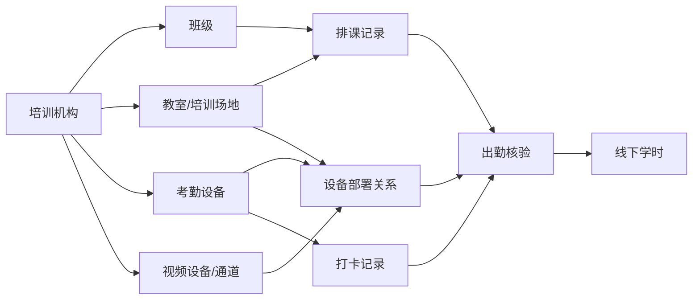

# 教室管理与考勤设备管理 PRD

## 1. 文档信息

| 项目   | 内容                                        |
| ---- | ----------------------------------------- |
| 文档名称 | 教室管理与考勤设备管理 PRD                           |
| 适用系统 | 安全生产智慧培训考试系统                              |
| 适用对象 | 培训机构账号、平台侧设备接入配置                          |
| 版本   | V0.7                                      |
| 设计目标 | 建立线下培训现场资源管理能力，为后续排课、打卡、视频抽查、线下学时核验提供基础数据 |

## 2. 背景与目标

当前系统已支持线上培训学时从三方网络培训平台同步，线下培训打卡照片也可通过系统线上导入。后续计划接入大华视频平台，并通过平台接入打卡机等考勤设备。为了避免班级、教室、设备之间强绑定导致后续维护困难，系统需要新增“教室管理”和“考勤设备管理”能力。

本次设计采用资源解耦、页面拆分的思路：

- 班级负责教学组织：谁参加培训、参加哪个培训项目。
- 教室负责线下现场：在哪里上课、是否具备培训条件。
- 设备负责现场采集：哪台打卡机、哪个视频通道采集现场数据。
- 排课负责临时关联：某个班级在某个时间使用某间教室。
- 设备部署负责现场关联：某台设备在某个时间段部署在哪间教室。

系统功能入口拆分为“教室管理”和“考勤设备管理”两个模块。教室管理面向培训场地维护，考勤设备管理面向设备资产维护和设备启停管理。设备部署关系作为两个模块之间的关联数据，不作为独立一级功能入口。

系统后续通过“排课时间 + 教室 + 设备部署关系 + 打卡记录”核验线下出勤和学时。

## 3. 设计原则

1. 班级、教室、设备三者解耦，不做固定强绑定。
2. 教室作为线下培训现场点位，是连接班级排课和设备采集的中间对象。
3. 设备启用、停用不影响班级和历史排课，班级调整不影响设备资产。
4. 培训机构侧按单账号设计，不单独拆分机构内角色和权限。
5. 所有部署、解除部署、启用、停用、变更操作必须留痕。
6. 历史数据按当时的排课和设备部署关系追溯，不随当前配置变化而变化。
7. 设备状态只区分启用、停用。启用设备可参与部署和打卡核验，停用设备不参与新的打卡核验。
8. 页面层面拆分教室管理和考勤设备管理，降低机构账号使用复杂度；关系层面保留设备部署关系，保证业务核验闭环。

## 4. 业务关系图

## 5. 账号与操作边界

培训机构侧当前只有一个账号，不在本期拆分机构管理员、教务人员等内部角色。机构账号进入系统后，可在“教室管理”中维护本机构教室信息，在“考勤设备管理”中查看本机构考勤设备状态，并进行设备启用、停用等操作。

教室信息和设备信息均按当前登录培训机构自动归属，机构侧页面不提供机构选择、机构查询或额外归属配置。平台侧负责大华平台接入、设备同步接口和异常处理配置等后台能力，后续抽查模块可复用教室、设备、部署关系和打卡异常数据。

## 6. 教室管理

### 6.1 功能定位

教室是线下培训发生地点的基础档案，也是排课和设备部署的共同关联对象。系统不要求班级直接绑定设备，而是要求班级排课选择教室，设备通过部署关系关联教室。

### 6.2 教室信息

| 字段   | 说明             |
| ---- | -------------- |
| 教室名称 | 如第一教室、实操培训室    |
| 教室地址 | 详细地址，可默认继承机构地址 |
| 教室容量 | 可容纳学员人数        |
| 教室类型 | 理论教室、实操教室、其他   |
| 使用状态 | 启用、停用          |
| 备注   | 其他说明           |

教室归属由当前登录培训机构自动写入，不在机构侧页面展示为可编辑字段。

### 6.3 教室列表

机构侧支持按教室名称、教室类型、状态查询。列表展示教室名称、地址、容量、当前状态、当前是否有部署设备、是否有正在进行的课程。

### 6.4 新增教室

机构账号可新增教室。新增时至少填写教室名称、地址、容量、教室类型。系统校验同一机构下教室名称不可重复。

### 6.5 编辑教室

允许修改教室名称、地址、容量、类型、备注等基础信息。若教室已有历史排课或设备部署记录，修改地址等关键字段时需要记录变更日志。

### 6.6 停用教室

教室停用后：

- 不允许被新排课选择。
- 不允许新增设备部署关系。
- 历史排课、打卡、学时记录保留。
- 若存在未结束课程或有效设备部署关系，系统应提示先处理关联数据。

### 6.7 教室占用查看

支持查看某间教室在日历上的排课占用情况，用于避免同一时间重复排课。

## 7. 考勤设备管理

### 7.1 功能定位

考勤设备是线下培训现场打卡数据的采集来源。设备可以来源于大华平台同步，也可以由系统管理员手工维护基础信息后再与大华平台设备进行关联。

### 7.2 设备信息

| 字段   | 说明           |
| ---- | ------------ |
| 设备名称 | 设备展示名称       |
| 设备编号 | 大华平台或系统内唯一编号 |
| 接入来源 | 大华平台、手工维护    |
| 设备状态 | 启用、停用        |
| 备注   | 其他说明         |

设备归属由当前登录培训机构自动写入，不在机构侧页面展示为可编辑字段。

### 7.3 设备列表

机构侧支持按设备编号、设备名称、设备状态查询。列表展示设备编号、设备名称、设备状态、当前部署教室。

### 7.4 设备同步

系统支持从大华视频平台同步考勤设备基础信息。同步后设备进入未部署状态，需要系统管理员或机构账号完成部署配置后才能参与出勤核验。

### 7.5 设备启用、停用

- 启用：设备可部署到教室并参与打卡核验。
- 停用：设备不再参与新打卡核验，历史记录保留。
  设备停用时，如果该设备存在有效部署关系，系统应提示机构先处理部署关系，避免停用后仍被排课或打卡核验使用。

## 8. 设备部署关系

### 8.1 功能定位

设备部署关系用于描述“某台设备在某个时间段部署在哪间教室”。系统根据部署关系判断打卡记录发生的现场位置。

### 8.2 业务规则

1. 同一时间段内，一台考勤设备原则上只能部署到一间教室。
2. 一间教室同一时间可部署一台考勤设备。
3. 设备部署必须记录生效时间和失效时间。
4. 设备部署调整时新增部署记录，不覆盖历史部署记录。
5. 已产生打卡记录的部署关系不允许物理删除，只允许终止。
6. 设备部署调整时，应保留原设备部署记录和新设备部署记录，不能直接覆盖原部署关系。
7. 同一教室内调整设备时，部署时间应连续或明确记录空档时间，系统按实际生效时间匹配打卡记录。

### 8.3 部署操作

部署时由系统自动带入当前登录培训机构，机构账号选择教室、设备、生效时间。系统校验设备状态、教室状态、时间段冲突。部署成功后，该设备产生的打卡记录可按部署关系归属到对应教室。

### 8.4 部署调整

设备从一间教室调整到另一间教室时，应先终止原部署关系，再新增新部署关系。系统记录变更人、变更时间、变更原因。

## 9. 与排课、打卡、学时的关系

### 9.1 排课使用教室

班级排课时选择教室，不直接选择考勤设备。系统根据课程时间和教室自动识别当时部署的考勤设备。

### 9.2 打卡记录匹配

打卡数据进入系统后，匹配逻辑如下：

1. 根据打卡记录识别设备。
2. 根据设备部署关系定位教室。
3. 根据打卡时间和教室匹配排课记录。
4. 校验打卡人员是否为该班级学员或该课程教师。
5. 匹配成功后生成有效出勤记录，失败则生成异常记录。

### 9.3 学时计算前置条件

线下学时计算至少需要满足：

- 存在有效排课。
- 排课教室有效。
- 打卡设备在打卡时间已部署到该教室。
- 学员属于该班级。
- 教师打卡符合课程要求。

## 10. 异常场景

| 异常             | 处理方式                                |
| -------------- | ----------------------------------- |
| 大华设备同步失败       | 记录同步失败原因，提示重新同步或检查平台连接，不改变设备启用、停用状态 |
| 设备停用后仍存在有效部署关系 | 提示机构先终止或调整部署关系                      |
| 打卡设备未部署        | 打卡记录进入待匹配异常                         |
| 教室停用仍被排课       | 阻断排课                                |
| 同一教室同时间多班排课    | 阻断排课                                |
| 同一设备同时间部署多教室   | 阻断部署                                |
| 学员跨教室打卡        | 记录无效或进入异常记录                         |
| 课程中途调整设备       | 新旧设备均按部署时间归属同一教室，打卡记录可共同参与同一节课出勤核验  |

## 11. 页面清单

| 模块     | 页面   | 说明                      |
| ------ | ---- | ----------------------- |
| 教室管理   | 教室列表 | 查询、新增、编辑、停用、查看占用        |
| 教室管理   | 教室详情 | 基础信息、历史排课、当前部署设备、设备部署历史 |
| 考勤设备管理 | 设备列表 | 查看设备状态、部署教室             |
| 考勤设备管理 | 设备详情 | 基础信息、设备状态、部署历史          |
| 考勤设备管理 | 设备启停 | 启用设备、停用设备               |
| 考勤设备管理 | 设备同步 | 同步设备、查看同步结果、处理未部署设备     |

设备部署关系不作为独立一级页面。教室详情和设备详情均可查看部署历史；设备部署调整时由系统保留旧部署并生成新部署记录。

## 12. 非本期范围

以下能力建议放到后续阶段：

- 视频回放联动抽查。
- 人脸相似度自动比对。
- 教室人数智能识别。
- 打卡异常自动告警短信或 App 推送。
- 基于视频 AI 的到课人数核验。

## 13. 验收标准

1. 培训机构可以维护本机构教室。
2. 系统可以维护或同步考勤设备。
3. 设备可以通过部署关系关联到教室。
4. 班级排课时可以选择教室，不需要直接选择设备。
5. 系统能够根据设备部署关系识别打卡发生教室。
6. 设备、教室、部署关系的关键变更均有日志。
7. 停用教室、停用设备不影响历史数据追溯。
8. 设备状态只允许启用、停用。
9. 设备列表字段限定为设备编号、设备名称、设备状态、部署教室、操作。
10. 设备详情展示基础信息、设备状态和部署历史，不设计打卡类型维度。

